# BÁO CÁO ĐỒ ÁN KỸ THUẬT PHẦN MỀM

## Hệ thống RAG tra cứu Luật Giao thông đường bộ Việt Nam

**Môn học:** Kỹ thuật phần mềm
**Tên đồ án:** Hệ thống hỏi–đáp luật giao thông có trích dẫn nguồn (RAG)
**Phiên bản:** 1.0
**Ngày:** 24/08/2026

### Thành viên nhóm

| STT | MSSV | Họ và tên | Vai trò |
|---:|---|---|---|
| 1 | [MSSV] | [Họ tên] | Trưởng nhóm, kiến trúc backend |
| 2 | [MSSV] | [Họ tên] | Frontend, giao diện chat |
| 3 | [MSSV] | [Họ tên] | Xử lý dữ liệu, kiểm thử |

**Giảng viên hướng dẫn:** [Tên giảng viên]

---

# MỤC LỤC

*(Tạo tự động bằng chức năng Table of Contents của Word.)*

# DANH MỤC HÌNH

*(Tạo tự động.)*

# DANH MỤC BẢNG

*(Tạo tự động.)*

# DANH MỤC TỪ VIẾT TẮT

| Từ viết tắt | Ý nghĩa |
|---|---|
| RAG | Retrieval-Augmented Generation (sinh câu trả lời có tăng cường truy hồi) |
| SRS | Đặc tả yêu cầu phần mềm |
| SDD | Tài liệu thiết kế phần mềm |
| LLM | Large Language Model (mô hình ngôn ngữ lớn) |
| UML | Ngôn ngữ mô hình hóa thống nhất |
| API | Giao diện lập trình ứng dụng |
| UI | Giao diện người dùng |
| DB | Cơ sở dữ liệu |
| BM25 | Thuật toán xếp hạng theo từ khóa (Best Matching 25) |
| RRF | Reciprocal Rank Fusion (hợp nhất theo nghịch đảo hạng) |
| PDF | Portable Document Format |
| HMAC | Hash-based Message Authentication Code |
| PBKDF2 | Password-Based Key Derivation Function 2 |
| CORS | Cross-Origin Resource Sharing |

---

# 1. GIỚI THIỆU

## 1.1 Bối cảnh

Luật giao thông đường bộ Việt Nam gồm nhiều văn bản (luật, nghị định, thông tư) với hàng trăm điều khoản, được sửa đổi theo thời gian. Người dân bình thường khó tra cứu đúng điều khoản áp dụng cho một tình huống cụ thể, còn việc tìm kiếm từ khóa thông thường trả về kết quả rời rạc, không tổng hợp và không dẫn nguồn.

Hệ thống được xây dựng theo mô hình RAG: người dùng mô tả tình huống bằng tiếng Việt, hệ thống tìm đúng điều khoản liên quan trong kho văn bản luật, rồi dùng mô hình ngôn ngữ lớn tổng hợp câu trả lời kèm trích dẫn số hiệu, Điều, Khoản và nhãn độ tin cậy.

## 1.2 Phát biểu bài toán

Cần một hệ thống hỏi–đáp cho phép:

- Nhận câu hỏi tiếng Việt mô tả tình huống giao thông.
- Trả lời **chỉ dựa trên văn bản luật thật**, không bịa đặt (chống hiện tượng ảo giác của mô hình ngôn ngữ).
- Kèm trích dẫn nguồn để người dùng kiểm chứng.
- Cho phép cập nhật luật mới bằng cách nạp tài liệu, **không cần huấn luyện lại** mô hình.

## 1.3 Mục tiêu của đồ án

- Xây dựng pipeline RAG hoàn chỉnh: nạp văn bản → cắt đoạn → sinh vector → tìm kiếm → tổng hợp có trích dẫn.
- Bảo đảm câu trả lời có căn cứ pháp lý rõ ràng và nhãn độ tin cậy.
- Cung cấp giao diện chat cho người dùng và khu quản trị để nạp/sửa/xóa văn bản.
- Thiết kế theo kiến trúc module để dễ mở rộng (đổi thuật toán tìm kiếm, đổi mô hình ngôn ngữ) mà không phải sửa phần lõi.

## 1.4 Phạm vi của đồ án

### Trong phạm vi

- Nạp và lập chỉ mục văn bản luật định dạng PDF/TXT.
- Cắt văn bản theo đơn vị Điều luật, sinh vector nhúng, lưu vào kho vector.
- Tra cứu bằng tìm kiếm vector (và tùy chọn tìm kiếm lai vector + BM25).
- Tổng hợp câu trả lời có trích dẫn bằng mô hình ngôn ngữ lớn.
- Giao diện chat, lịch sử trò chuyện lưu trên trình duyệt và khu quản trị có xác thực bằng mật khẩu.

### Ngoài phạm vi

- Tư vấn pháp lý chính thức (hệ thống chỉ mang tính tham khảo).
- Quản lý nhiều tài khoản người dùng với phân quyền chi tiết (chỉ có một vai trò admin dùng chung mật khẩu).
- Nhận dạng văn bản từ ảnh scan (PDF scan bị từ chối).
- Ứng dụng di động gốc.

## 1.5 Các bên liên quan

| Bên liên quan | Mô tả | Mối quan tâm / Lợi ích |
|---|---|---|
| Người dùng cuối | Người dân tra cứu tình huống giao thông | Câu trả lời đúng, dễ hiểu, có dẫn nguồn |
| Quản trị viên | Người nạp và bảo trì kho văn bản luật | Nạp/sửa/xóa văn bản an toàn, không lộ cho người ngoài |
| Nhóm phát triển | Sinh viên xây dựng và bảo trì hệ thống | Mã dễ mở rộng, dễ kiểm thử, dễ đổi mô hình |
| Giảng viên hướng dẫn | Đánh giá đồ án | Thiết kế đúng chuẩn, tài liệu đầy đủ |

## 1.6 Thuật ngữ và định nghĩa

| Thuật ngữ | Định nghĩa |
|---|---|
| Chunk (đoạn) | Một đơn vị văn bản được cắt ra để lập chỉ mục; ở đây mỗi Điều luật là một chunk |
| Vector nhúng | Biểu diễn số học (1024 chiều) của một đoạn văn, dùng để đo độ tương đồng ngữ nghĩa |
| Lọc theo ngưỡng (Gating) | Bước kiểm tra điểm tương đồng để quyết định có gọi mô hình ngôn ngữ hay không |
| Độ tin cậy | Nhãn (cao / trung bình / thấp) suy từ điểm tương đồng cao nhất |
| Số hiệu | Mã định danh văn bản, ví dụ 36/2024/QH15 |

---

# 2. TỔNG QUAN HỆ THỐNG

## 2.1 Mục đích và vai trò của hệ thống

Hệ thống đóng vai trò trung gian giữa người dùng và kho văn bản luật giao thông. Hệ thống nhận câu hỏi, truy hồi các điều khoản liên quan từ kho vector, và sinh câu trả lời có trích dẫn. Hệ thống chạy cục bộ: mô hình sinh vector nhúng chạy trên máy, kho dữ liệu lưu trên đĩa, chỉ có bước tổng hợp câu trả lời gọi ra dịch vụ mô hình ngôn ngữ bên ngoài.

## 2.2 Bối cảnh hệ thống

Người dùng và quản trị viên tương tác với hệ thống qua giao diện web. Hệ thống phụ thuộc ba thành phần: kho vector ChromaDB (lưu đĩa), mô hình sinh vector nhúng (chạy cục bộ), và dịch vụ mô hình ngôn ngữ lớn (gọi qua HTTPS).

**Hình 2-1. Sơ đồ ngữ cảnh hệ thống**

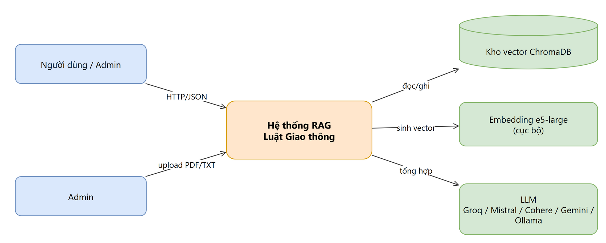

Bảng mô tả các thành phần trong sơ đồ ngữ cảnh:

| Thành phần | Vai trò |
|---|---|
| Người dùng / Admin | Gửi câu hỏi hoặc thao tác quản trị qua HTTP/JSON |
| Hệ thống RAG Luật Giao thông | Xử lý câu hỏi, điều phối tìm kiếm và tổng hợp |
| Kho vector ChromaDB | Lưu đoạn văn bản và vector, tìm theo độ tương đồng |
| Embedding e5-large (cục bộ) | Sinh vector 1024 chiều cho câu hỏi và đoạn văn |
| LLM (Groq/Mistral/Cohere/Gemini/Ollama) | Tổng hợp câu trả lời có trích dẫn |

## 2.3 Các chức năng chính

| Mã | Chức năng | Mô tả |
|---|---|---|
| F-01 | Tra cứu luật | Người dùng đặt câu hỏi, nhận câu trả lời có trích dẫn và độ tin cậy |
| F-02 | Xem danh sách văn bản | Liệt kê các văn bản đã nạp (số hiệu, tên, số đoạn) |
| F-03 | Đăng nhập quản trị | Xác thực admin bằng mật khẩu để mở khu quản lý |
| F-04 | Nạp văn bản | Upload PDF/TXT, hệ thống cắt đoạn, sinh vector, lưu kho |
| F-05 | Sửa thông tin văn bản | Cập nhật metadata (tên, số hiệu, loại, cơ quan) không cần nạp lại |
| F-06 | Xóa văn bản | Xóa toàn bộ đoạn của một văn bản theo số hiệu |
| F-07 | Quản lý lịch sử trò chuyện | Tạo, chuyển và xóa cuộc trò chuyện; lưu cục bộ trên trình duyệt |

## 2.4 Công nghệ sử dụng

| Thành phần | Công nghệ |
|---|---|
| Frontend | React 19 + Vite + TypeScript + Tailwind CSS |
| Backend | Python 3.11+ / FastAPI (bất đồng bộ) |
| Cơ sở dữ liệu | ChromaDB (vector database, lưu đĩa, nhúng) |
| Sinh vector nhúng | sentence-transformers `intfloat/multilingual-e5-large` (1024 chiều) |
| Mô hình ngôn ngữ | Groq / Mistral / Cohere / Gemini / Ollama (đổi qua cấu hình) |
| Đọc PDF | PyMuPDF |
| Xác thực | Mật khẩu băm PBKDF2 + token ký HMAC (stateless) |
| Triển khai | Chạy cục bộ (backend cổng 8000, frontend cổng 5173) |

---

# 3. ĐẶC TẢ YÊU CẦU

## 3.1 Yêu cầu chức năng

| Mã | Yêu cầu | Độ ưu tiên |
|---|---|---|
| FR-01 | Hệ thống phải nhận câu hỏi tiếng Việt (1–1000 ký tự) và trả câu trả lời tổng hợp. | Cao |
| FR-02 | Hệ thống phải kèm trích dẫn (số hiệu, Điều, Khoản) cho mỗi câu trả lời có căn cứ. | Cao |
| FR-03 | Hệ thống phải gán nhãn độ tin cậy (cao / trung bình / thấp) cho câu trả lời. | Cao |
| FR-04 | Hệ thống không gọi mô hình ngôn ngữ khi không tìm được đoạn đủ liên quan. | Cao |
| FR-05 | Hệ thống phải cho phép nạp văn bản PDF/TXT và lập chỉ mục tự động. | Cao |
| FR-06 | Hệ thống phải từ chối văn bản trùng số hiệu và PDF scan (không đọc được text). | Trung bình |
| FR-07 | Hệ thống phải cho phép liệt kê văn bản đã nạp theo trang. | Trung bình |
| FR-08 | Hệ thống phải cho phép sửa metadata văn bản mà không nạp lại. | Trung bình |
| FR-09 | Hệ thống phải cho phép xóa văn bản theo số hiệu. | Trung bình |
| FR-10 | Hệ thống phải yêu cầu đăng nhập admin cho các thao tác ghi (nạp/sửa/xóa). | Cao |
| FR-11 | Khi mô hình ngôn ngữ lỗi, hệ thống phải trả về nội dung đoạn gốc thay vì báo lỗi. | Trung bình |
| FR-12 | Giao diện phải cho phép tạo, chuyển, xóa và tự động lưu lịch sử trò chuyện trên trình duyệt. | Trung bình |

### FR-01 – Tra cứu luật giao thông

**Mô tả:** Người dùng nhập câu hỏi mô tả tình huống; hệ thống trả câu trả lời tổng hợp theo 4 mục (Phân tích / Giải pháp / Căn cứ / Lưu ý).

**Đầu vào:** Chuỗi câu hỏi tiếng Việt, độ dài 1–1000 ký tự.

**Xử lý:** Sinh vector câu hỏi → tìm đoạn liên quan → lọc theo ngưỡng → gọi mô hình ngôn ngữ tổng hợp có đánh số trích dẫn.

**Đầu ra:** Câu trả lời dạng markdown + danh sách trích dẫn + nhãn độ tin cậy.

**Quy tắc nghiệp vụ liên quan:** BR-01, BR-02, BR-03.

### FR-02 – Kèm trích dẫn nguồn

**Mô tả:** Mỗi câu trả lời có căn cứ phải kèm danh sách trích dẫn tương ứng các đoạn được dùng.

**Đầu vào:** Danh sách đoạn liên quan sau truy hồi.

**Xử lý:** Với mỗi đoạn (tối đa 6), tạo một trích dẫn gồm số hiệu, tên văn bản, Điều, Khoản và nội dung đầy đủ; số [n] trong câu trả lời khớp thứ tự trích dẫn.

**Đầu ra:** Mảng trích dẫn kèm theo câu trả lời.

**Quy tắc nghiệp vụ liên quan:** BR-03.

### FR-03 – Gán nhãn độ tin cậy

**Mô tả:** Mỗi câu trả lời được gán nhãn độ tin cậy để người dùng cân nhắc.

**Đầu vào:** Điểm tương đồng cosine cao nhất trong các đoạn truy hồi.

**Xử lý:** Suy nhãn theo ngưỡng: ≥ 0.8 → "cao"; ≥ 0.5 → "trung bình"; còn lại → "thấp".

**Đầu ra:** Nhãn độ tin cậy (cao / trung bình / thấp) trong kết quả.

**Quy tắc nghiệp vụ liên quan:** BR-01, BR-02.

### FR-04 – Không gọi mô hình khi thiếu căn cứ

**Mô tả:** Khi không tìm được đoạn đủ liên quan, hệ thống không gọi mô hình ngôn ngữ để tránh bịa đặt.

**Đầu vào:** Điểm tương đồng cao nhất.

**Xử lý:** Nếu điểm < 0.3 → báo "không tìm thấy điều khoản phù hợp"; nếu 0.3 ≤ điểm < 0.5 → báo "không tìm thấy văn bản đủ liên quan"; cả hai trường hợp đều không gọi mô hình.

**Đầu ra:** Thông báo không có kết quả, trích dẫn rỗng, độ tin cậy thấp.

**Quy tắc nghiệp vụ liên quan:** BR-01, BR-02.

### FR-05 – Nạp văn bản

**Mô tả:** Quản trị viên tải tệp luật lên kèm thông tin mô tả (metadata); hệ thống cắt đoạn, sinh vector và lưu vào kho.

**Đầu vào:** Tệp PDF/TXT (≤ 50MB), thông tin mô tả (số hiệu, tên, ngày ban hành, ngày hiệu lực, cơ quan, loại) và phiếu truy cập (token) admin.

**Xử lý:** Kiểm tra kích thước, định dạng và trùng lặp → đọc văn bản → cắt theo Điều → sinh vector → lưu kho.

**Đầu ra:** Kết quả gồm số hiệu, tên văn bản, số đoạn đã tạo và thời điểm lập chỉ mục.

**Quy tắc nghiệp vụ liên quan:** BR-04, BR-05, BR-06, BR-07.

### FR-06 – Từ chối văn bản trùng số hiệu và PDF scan

**Mô tả:** Khi nạp, hệ thống từ chối văn bản trùng số hiệu và PDF không trích được text.

**Đầu vào:** File + metadata khi nạp.

**Xử lý:** Kiểm tra số hiệu đã tồn tại (và không yêu cầu thay thế) → lỗi 409; đọc text, nếu rỗng (PDF scan) → lỗi 400.

**Đầu ra:** Lỗi 409 (trùng) hoặc 400 (scan).

**Quy tắc nghiệp vụ liên quan:** BR-05, BR-06.

### FR-07 – Liệt kê văn bản theo trang

**Mô tả:** Người dùng/admin xem danh sách văn bản đã nạp.

**Đầu vào:** Tham số trang (page) và kích thước trang (page_size).

**Xử lý:** Gom các đoạn theo số hiệu, đếm số đoạn mỗi văn bản, phân trang.

**Đầu ra:** Danh sách văn bản (số hiệu, tên, loại, số đoạn) kèm tổng số và thông tin trang.

**Quy tắc nghiệp vụ liên quan:** Không.

### FR-08 – Sửa metadata văn bản không nạp lại

**Mô tả:** Admin cập nhật metadata của một văn bản mà không phải nạp và sinh vector lại.

**Đầu vào:** Số hiệu + các trường cần sửa + token admin.

**Xử lý:** Ghi đè các trường chỉ định cho mọi đoạn thuộc văn bản, giữ nguyên text và vector; nếu đổi số hiệu thì dựng lại id (tái dùng vector), kiểm tra số hiệu mới không trùng.

**Đầu ra:** Số đoạn đã cập nhật.

**Quy tắc nghiệp vụ liên quan:** BR-07.

### FR-09 – Xóa văn bản theo số hiệu

**Mô tả:** Admin xóa toàn bộ đoạn của một văn bản khỏi kho.

**Đầu vào:** Số hiệu + token admin.

**Xử lý:** Tìm mọi đoạn có số hiệu tương ứng và xóa; nếu không có → lỗi 404.

**Đầu ra:** Số đoạn đã xóa.

**Quy tắc nghiệp vụ liên quan:** BR-07.

### FR-10 – Yêu cầu đăng nhập cho thao tác ghi

**Mô tả:** Các điểm truy cập (endpoint) nạp, sửa và xóa văn bản chỉ chấp nhận yêu cầu có phiếu truy cập (token) admin hợp lệ.

**Đầu vào:** Header `Authorization: Bearer <token>`.

**Xử lý:** Kiểm tra chữ ký HMAC và thời hạn của phiếu truy cập; nếu sai hoặc hết hạn thì trả lỗi 401.

**Đầu ra:** Cho phép thực hiện thao tác hoặc trả lỗi 401.

**Quy tắc nghiệp vụ liên quan:** BR-07.

### FR-11 – Dự phòng khi mô hình ngôn ngữ lỗi

**Mô tả:** Khi mô hình ngôn ngữ lỗi hoặc timeout lúc tổng hợp, hệ thống vẫn trả kết quả thay vì báo lỗi trắng.

**Đầu vào:** Các đoạn liên quan đã truy hồi và lỗi từ mô hình.

**Xử lý:** Bắt ngoại lệ khi gọi mô hình; trả về nội dung các đoạn gốc (chunksGoc) kèm trích dẫn và độ tin cậy đã tính.

**Đầu ra:** Thông báo mô hình tạm không khả dụng + nội dung đoạn gốc + trích dẫn.

**Quy tắc nghiệp vụ liên quan:** BR-03.

### FR-12 – Quản lý lịch sử trò chuyện

**Mô tả:** Giao diện cho phép người dùng tạo cuộc trò chuyện mới, chuyển giữa các cuộc đã lưu và xóa cuộc không còn cần thiết.

**Đầu vào:** Hành động tạo mới/chuyển/xóa; câu hỏi và câu trả lời phát sinh trong cuộc trò chuyện.

**Xử lý:** Tạo mã bằng `crypto.randomUUID()`; lấy tiêu đề từ câu hỏi đầu tiên; sắp xếp theo thời gian cập nhật; chỉ lưu cuộc có tin nhắn vào bộ nhớ cục bộ của trình duyệt (`localStorage`).

**Đầu ra:** Thanh lịch sử cập nhật; cuộc trò chuyện được chọn hiển thị đúng các tin nhắn đã lưu.

**Quy tắc nghiệp vụ liên quan:** BR-08.

## 3.2 Yêu cầu phi chức năng

| Mã | Loại | Yêu cầu |
|---|---|---|
| NFR-01 | Hiệu năng | Sau khi mô hình embedding đã được nạp, thời gian truy hồi mục tiêu ≤ 2 giây; tổng thời gian trả lời mục tiêu ≤ 10 giây khi dịch vụ LLM hoạt động bình thường. |
| NFR-02 | Bảo mật | Mật khẩu admin lưu dạng băm PBKDF2; token ký HMAC có hạn; thao tác ghi cần token. |
| NFR-03 | Độ tin cậy | Khi mô hình ngôn ngữ lỗi/timeout, hệ thống vẫn trả kết quả (đoạn gốc). |
| NFR-04 | Khả năng bảo trì | Kiến trúc module: đổi thuật toán tìm kiếm/mô hình qua cấu hình, không sửa lõi. |
| NFR-05 | Khả năng sử dụng | Giao diện chat tiếng Việt, hiển thị markdown và trích dẫn bấm được. |
| NFR-06 | Khả năng mở rộng | Thêm luật mới bằng nạp file, không cần huấn luyện lại mô hình. |
| NFR-07 | Khả năng kiểm thử | Có bộ kiểm thử tự động dùng mô hình giả và ChromaDB trong bộ nhớ. |
| NFR-08 | Riêng tư dữ liệu | Lịch sử trò chuyện chỉ lưu trong `localStorage` của trình duyệt hiện tại, không gửi lên backend ngoài nội dung câu hỏi đang tra cứu. |

## 3.3 Quy tắc nghiệp vụ

| Mã | Quy tắc nghiệp vụ |
|---|---|
| BR-01 | Chỉ tổng hợp câu trả lời khi điểm tương đồng cao nhất ≥ 0.5; dưới ngưỡng thì báo không đủ liên quan. |
| BR-02 | Không tổng hợp khi điểm cao nhất < 0.3 (báo không tìm thấy điều khoản phù hợp). |
| BR-03 | Câu trả lời chỉ được dẫn các đoạn [1..N] có trong ngữ cảnh; nếu thiếu căn cứ phải nêu rõ ở mục Lưu ý. |
| BR-04 | Mỗi Điều luật là một đoạn; Điều quá dài mới cắt nhỏ và gắn lại tiêu đề Điều. |
| BR-05 | Không nạp văn bản trùng số hiệu (trừ khi yêu cầu thay thế). |
| BR-06 | Từ chối PDF không trích được text (PDF scan). |
| BR-07 | Chỉ admin có token hợp lệ mới được nạp/sửa/xóa văn bản khi xác thực đã được cấu hình. |
| BR-08 | Lịch sử chỉ lưu cuộc trò chuyện có tin nhắn; tối đa 50 cuộc, 100 tin nhắn mỗi cuộc; tiêu đề lấy từ tối đa 60 ký tự của câu hỏi đầu tiên. |

## 3.4 Các ràng buộc của hệ thống

- File nạp lên tối đa 50MB, chỉ định dạng PDF hoặc TXT.
- Mô hình sinh vector nhúng chạy CPU cục bộ, lần nạp đầu tải model khoảng 2GB.
- Vector nhúng cố định 1024 chiều theo mô hình e5-large.
- Chỉ một vai trò admin dùng chung mật khẩu (không có cơ sở dữ liệu người dùng).

## 3.5 Các giả định

- Văn bản luật đầu vào là PDF/TXT có text (không phải ảnh scan).
- Máy chạy có kết nối Internet để gọi dịch vụ mô hình ngôn ngữ (trừ khi dùng Ollama cục bộ).
- Người dùng nhập câu hỏi bằng tiếng Việt.

---

# 4. PHÂN TÍCH USE CASE

## 4.1 Tác nhân

| Tác nhân | Mô tả |
|---|---|
| Người dùng | Người tra cứu luật; chỉ dùng chức năng công khai (hỏi–đáp, xem danh sách văn bản). |
| Quản trị viên | Người quản lý kho văn bản; sau khi đăng nhập được nạp/sửa/xóa văn bản. |
| Dịch vụ LLM | Hệ thống bên ngoài, nhận prompt và trả câu trả lời tổng hợp. |

## 4.2 Sơ đồ Use Case

**Hình 4-1. Sơ đồ Use Case**

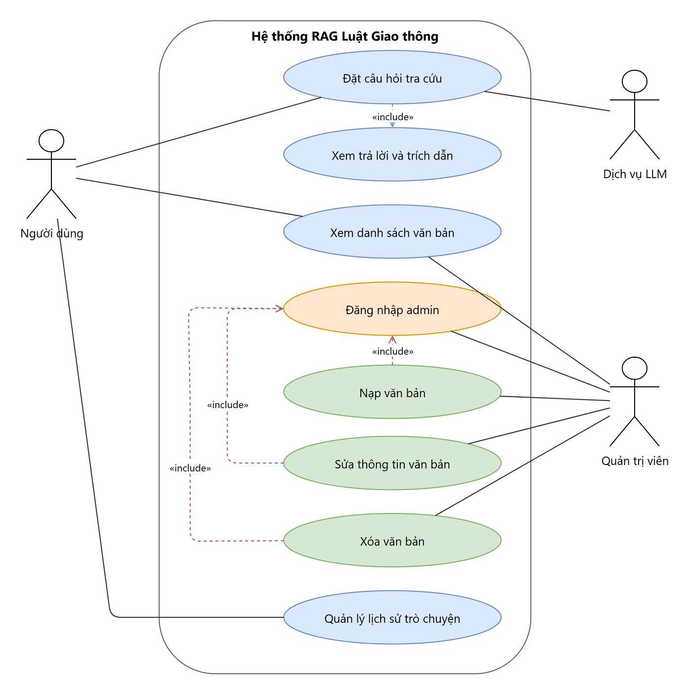

Bảng mô tả các thành phần trong sơ đồ Use Case:

| Phần tử | Loại | Mô tả |
|---|---|---|
| Người dùng | Actor | Truy cập chức năng công khai |
| Quản trị viên | Actor | Truy cập chức năng quản lý sau khi đăng nhập |
| Dịch vụ LLM | Actor hỗ trợ | Tổng hợp câu trả lời cho UC-01 |
| Đặt câu hỏi tra cứu | Use case chính | Gửi câu hỏi và nhận kết quả |
| Xem trả lời và trích dẫn | Use case được bao gồm («include») | Là bước bắt buộc trong UC-01, không phải use case độc lập |
| Xem danh sách văn bản | Use case | Liệt kê văn bản đã nạp |
| Đăng nhập admin | Use case | Xác thực để mở khu quản lý |
| Nạp / Sửa / Xóa văn bản | Use case | Thao tác ghi, bao gồm («include») bước đăng nhập admin |
| Quản lý lịch sử trò chuyện | Use case | Tạo, chuyển và xóa lịch sử lưu trên trình duyệt |

## 4.3 Danh sách Use Case

| Mã | Use Case | Tác nhân | Mô tả |
|---|---|---|---|
| UC-01 | Đặt câu hỏi tra cứu | Người dùng | Nhập câu hỏi, nhận câu trả lời có trích dẫn |
| UC-02 | Xem danh sách văn bản | Người dùng, Admin | Xem các văn bản đã nạp theo trang |
| UC-03 | Đăng nhập admin | Quản trị viên | Đăng nhập bằng mật khẩu, nhận token |
| UC-04 | Nạp văn bản | Quản trị viên | Upload file luật, hệ thống lập chỉ mục |
| UC-05 | Sửa thông tin văn bản | Quản trị viên | Cập nhật metadata văn bản |
| UC-06 | Xóa văn bản | Quản trị viên | Xóa văn bản theo số hiệu |
| UC-07 | Quản lý lịch sử trò chuyện | Người dùng | Tạo mới, chuyển và xóa cuộc trò chuyện đã lưu |

## 4.4 Đặc tả Use Case

### UC-01 – Đặt câu hỏi tra cứu

**Tác nhân chính:** Người dùng.

**Mục tiêu:** Nhận câu trả lời có căn cứ pháp lý cho một tình huống giao thông.

**Điều kiện tiên quyết:** Kho văn bản đã có dữ liệu.

**Điều kiện sau:** Người dùng nhận câu trả lời + trích dẫn + độ tin cậy (hoặc thông báo không tìm thấy).

**Luồng chính:**

| Bước | Tác nhân | Hệ thống |
|---:|---|---|
| 1 | Nhập câu hỏi và gửi | |
| 2 | | Sinh vector câu hỏi |
| 3 | | Tìm các đoạn liên quan trong kho |
| 4 | | Lọc theo ngưỡng tương đồng |
| 5 | | Gọi mô hình ngôn ngữ tổng hợp câu trả lời có đánh số trích dẫn |
| 6 | | Trả câu trả lời + trích dẫn + độ tin cậy |

**Luồng thay thế:**

**A1 – Không đủ liên quan:** Ở bước 4, nếu điểm cao nhất < 0.5 thì hệ thống báo "Không tìm thấy văn bản đủ liên quan" và không gọi mô hình ngôn ngữ.

**Luồng ngoại lệ:**

**E1 – Mô hình ngôn ngữ lỗi/timeout:** Ở bước 5, hệ thống trả về nội dung các đoạn gốc kèm trích dẫn (fallback).

**Quy tắc nghiệp vụ:** BR-01, BR-02, BR-03.

**Yêu cầu liên quan:** FR-01, FR-02, FR-03, FR-04, FR-11.

### UC-02 – Xem danh sách văn bản

**Tác nhân chính:** Người dùng / Quản trị viên.

**Mục tiêu:** Biết kho đang có những văn bản nào.

**Điều kiện tiên quyết:** Không.

**Điều kiện sau:** Hiển thị danh sách văn bản (số hiệu, tên, loại, số đoạn) theo trang.

**Luồng chính:**

| Bước | Tác nhân | Hệ thống |
|---:|---|---|
| 1 | Mở trang danh sách (chọn trang) | |
| 2 | | Gom các đoạn theo số hiệu, phân trang |
| 3 | | Trả danh sách văn bản |

**Yêu cầu liên quan:** FR-07.

### UC-03 – Đăng nhập admin

**Tác nhân chính:** Quản trị viên.

**Mục tiêu:** Lấy token để thực hiện thao tác ghi.

**Điều kiện tiên quyết:** Hệ thống đã cấu hình mật khẩu admin.

**Điều kiện sau:** Nhận token hợp lệ, mở khu quản lý.

**Luồng chính:**

| Bước | Tác nhân | Hệ thống |
|---:|---|---|
| 1 | Nhập mật khẩu và gửi | |
| 2 | | So mật khẩu với băm đã lưu |
| 3 | | Cấp token ký HMAC có hạn |
| 4 | Lưu token, mở khu quản lý | |

**Luồng ngoại lệ:**

**E1 – Sai mật khẩu:** Hệ thống chờ 1 giây (chống dò) rồi trả lỗi 401.

**Quy tắc nghiệp vụ:** BR-07.

**Yêu cầu liên quan:** FR-10.

### UC-04 – Nạp văn bản

**Tác nhân chính:** Quản trị viên.

**Mục tiêu:** Thêm một văn bản luật vào kho tra cứu.

**Điều kiện tiên quyết:** Đã đăng nhập (có token).

**Điều kiện sau:** Văn bản được cắt đoạn, sinh vector, lưu kho.

**Luồng chính:**

| Bước | Tác nhân | Hệ thống |
|---:|---|---|
| 1 | Upload file + metadata + token | |
| 2 | | Kiểm tra token, kích thước, định dạng, trùng lặp |
| 3 | | Đọc text, cắt theo Điều |
| 4 | | Sinh vector cho từng đoạn |
| 5 | | Lưu đoạn + vector vào kho |
| 6 | | Trả kết quả (số đoạn) |

**Luồng thay thế:**

**A1 – Trùng số hiệu:** Ở bước 2, nếu số hiệu đã tồn tại và không yêu cầu thay thế → trả lỗi 409.

**Luồng ngoại lệ:**

**E1 – PDF scan:** Ở bước 3, nếu không trích được text → trả lỗi 400.

**Quy tắc nghiệp vụ:** BR-04, BR-05, BR-06, BR-07.

**Yêu cầu liên quan:** FR-05, FR-06, FR-10.

### UC-05 – Sửa thông tin văn bản

**Tác nhân chính:** Quản trị viên.

**Mục tiêu:** Cập nhật metadata (tên, số hiệu, loại, cơ quan) mà không nạp lại.

**Điều kiện tiên quyết:** Đã đăng nhập; văn bản tồn tại.

**Điều kiện sau:** Metadata của mọi đoạn thuộc văn bản được cập nhật, giữ nguyên vector.

**Luồng chính:**

| Bước | Tác nhân | Hệ thống |
|---:|---|---|
| 1 | Gửi trường cần sửa + token | |
| 2 | | Kiểm tra token, kiểm tra số hiệu mới không trùng |
| 3 | | Cập nhật metadata mọi đoạn (tái dùng vector) |
| 4 | | Trả số đoạn đã cập nhật |

**Luồng ngoại lệ:**

**E1 – Không tìm thấy văn bản:** Trả lỗi 404. **E2 – Số hiệu mới đã tồn tại:** Trả lỗi 409.

**Quy tắc nghiệp vụ:** BR-07.

**Yêu cầu liên quan:** FR-08, FR-10.

### UC-06 – Xóa văn bản

**Tác nhân chính:** Quản trị viên.

**Mục tiêu:** Gỡ một văn bản khỏi kho.

**Điều kiện tiên quyết:** Đã đăng nhập; văn bản tồn tại.

**Điều kiện sau:** Mọi đoạn của văn bản bị xóa khỏi kho.

**Luồng chính:**

| Bước | Tác nhân | Hệ thống |
|---:|---|---|
| 1 | Gửi yêu cầu xóa theo số hiệu + token | |
| 2 | | Kiểm tra token |
| 3 | | Xóa mọi đoạn có số hiệu tương ứng |
| 4 | | Trả số đoạn đã xóa |

**Luồng ngoại lệ:**

**E1 – Không tìm thấy văn bản:** Trả lỗi 404.

**Quy tắc nghiệp vụ:** BR-07.

**Yêu cầu liên quan:** FR-09, FR-10.

### UC-07 – Quản lý lịch sử trò chuyện

**Tác nhân chính:** Người dùng.

**Mục tiêu:** Xem lại, chuyển đổi hoặc xóa các cuộc trò chuyện trên trình duyệt hiện tại.

**Điều kiện tiên quyết:** Trình duyệt hỗ trợ `localStorage`.

**Điều kiện sau:** Danh sách lịch sử và cuộc trò chuyện đang chọn được cập nhật.

**Luồng chính:**

| Bước | Tác nhân | Hệ thống |
|---:|---|---|
| 1 | Mở trang Chat | Tạo một cuộc trò chuyện mới rỗng và đọc lịch sử đã lưu |
| 2 | Gửi câu hỏi đầu tiên | Đặt tiêu đề theo câu hỏi, lưu tin nhắn vào cuộc hiện tại |
| 3 | Chọn một cuộc trong thanh lịch sử | Hiển thị lại các tin nhắn của cuộc được chọn |
| 4 | Chọn tạo cuộc mới | Bỏ cuộc rỗng cũ và tạo cuộc mới |
| 5 | Chọn xóa và xác nhận | Xóa cuộc đã chọn; bảo đảm luôn còn một cuộc hiện hành |

**Luồng ngoại lệ:**

**E1 – Dữ liệu lưu bị hỏng hoặc không đọc được:** Hệ thống ghi lỗi ở console và khởi tạo danh sách lịch sử rỗng.

**E2 – Không ghi được `localStorage`:** Hệ thống vẫn giữ dữ liệu trong bộ nhớ của phiên đang mở và ghi thông báo lỗi.

**Quy tắc nghiệp vụ:** BR-08.

**Yêu cầu liên quan:** FR-12, NFR-08.

---

# 5. PHÂN TÍCH HỆ THỐNG

## 5.1 Mô hình miền nghiệp vụ

Miền nghiệp vụ xoay quanh: **Văn bản pháp luật** gồm nhiều **Điều luật (Đoạn)**; mỗi đoạn sinh ra một **Vector** dùng để tìm kiếm. Người dùng gửi **Câu hỏi** và nhận **Câu trả lời** kèm **Trích dẫn** dẫn nguồn về đúng Điều luật. Ở phía trình duyệt, một **Cuộc trò chuyện** gồm nhiều **Tin nhắn** và được lưu cục bộ để người dùng xem lại.

**Hình 5-1. Mô hình miền nghiệp vụ**

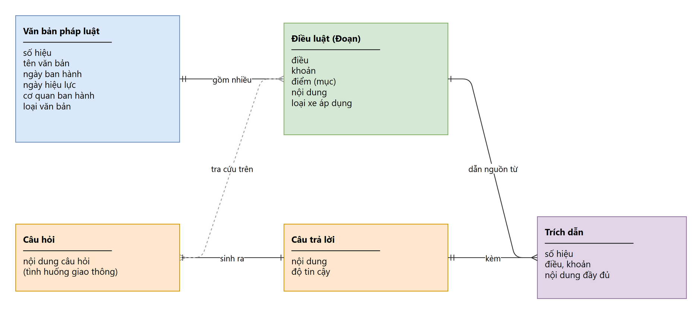

Bảng mô tả các thực thể miền:

| Thực thể | Thuộc tính chính | Vai trò |
|---|---|---|
| Văn bản pháp luật | số hiệu, tên, ngày ban hành/hiệu lực, cơ quan, loại | Đơn vị luật được nạp vào hệ thống |
| Điều luật (Đoạn) | điều, khoản, điểm, nội dung, loại xe áp dụng | Đơn vị pháp lý hoàn chỉnh để trích dẫn |
| Câu hỏi | nội dung tình huống | Đầu vào của người dùng |
| Câu trả lời | nội dung, độ tin cậy | Kết quả tổng hợp |
| Trích dẫn | số hiệu, điều, khoản, nội dung đầy đủ | Dẫn nguồn cho câu trả lời |
| Cuộc trò chuyện | mã, tiêu đề, thời gian tạo/cập nhật | Nhóm các tin nhắn của một phiên hỏi–đáp |
| Tin nhắn | mã, vai trò, nội dung, thời gian | Câu hỏi của người dùng hoặc câu trả lời của hệ thống |

## 5.2 Các lớp phân tích

Các lớp được chia theo ba nhóm: lớp giao diện (boundary) tiếp xúc người dùng, lớp điều khiển (control) xử lý nghiệp vụ, và lớp thực thể (entity) lưu dữ liệu.

| Lớp | Nhóm | Trách nhiệm |
|---|---|---|
| Giao diện Chat | Giao diện (boundary) | Nhận câu hỏi, hiển thị câu trả lời và trích dẫn |
| Thanh lịch sử Chat | Giao diện (boundary) | Hiển thị, chuyển, tạo và xóa cuộc trò chuyện |
| Bộ quản lý phiên Chat | Điều khiển (control) | Quản lý trạng thái phiên, gửi câu hỏi và giới hạn tin nhắn |
| Bộ lưu lịch sử Chat | Dịch vụ (service) | Đọc/ghi danh sách cuộc trò chuyện vào `localStorage` |
| Giao diện Quản lý | Giao diện (boundary) | Nạp, sửa, xóa văn bản và đăng nhập |
| Bộ điều phối tra cứu | Điều khiển (control) | Điều phối luồng hỏi–đáp |
| Bộ điều phối nạp văn bản | Điều khiển (control) | Điều phối luồng lập chỉ mục |
| Bộ xác thực admin | Điều khiển (control) | Kiểm tra mật khẩu, cấp và kiểm tra phiếu truy cập (token) |
| Câu hỏi / Câu trả lời | Thực thể (entity) | Dữ liệu tương tác |
| Kho điều luật (vector) | Thực thể (entity) | Lưu và tìm đoạn theo vector |
| Văn bản / Điều luật | Thực thể (entity) | Dữ liệu luật đã lập chỉ mục |
| Sinh vector + Mô hình ngôn ngữ | Dịch vụ (service) | Sinh vector và tổng hợp câu trả lời |

## 5.3 Sơ đồ lớp phân tích

**Hình 5-2. Sơ đồ lớp phân tích**

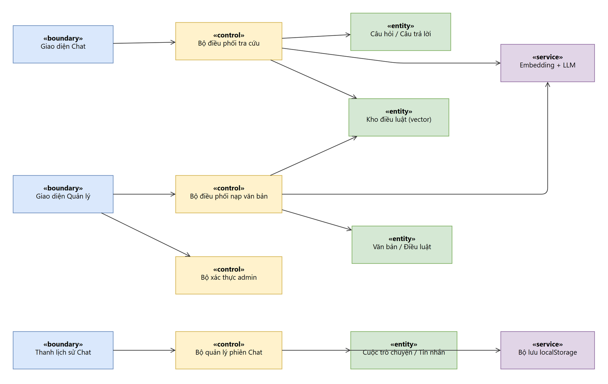

Bảng mô tả các lớp và quan hệ trong sơ đồ:

| Thành phần | Nhóm | Quan hệ chính |
|---|---|---|
| Giao diện Chat | Giao diện (boundary) | Gọi Bộ điều phối tra cứu |
| Thanh lịch sử Chat | Giao diện (boundary) | Gọi Bộ quản lý phiên Chat |
| Bộ quản lý phiên Chat | Điều khiển (control) | Quản lý Cuộc trò chuyện/Tin nhắn và gọi Bộ lưu lịch sử |
| Bộ lưu lịch sử Chat | Dịch vụ (service) | Đọc/ghi dữ liệu vào `localStorage` |
| Giao diện Quản lý | Giao diện (boundary) | Gọi Bộ điều phối nạp văn bản và Bộ xác thực admin |
| Bộ điều phối tra cứu | Điều khiển (control) | Dùng Câu hỏi/Câu trả lời, Kho điều luật và dịch vụ mô hình |
| Bộ điều phối nạp văn bản | Điều khiển (control) | Dùng Văn bản/Điều luật, Kho điều luật và dịch vụ sinh vector |
| Bộ xác thực admin | Điều khiển (control) | Xác thực thao tác quản trị |
| Câu hỏi / Câu trả lời | Thực thể (entity) | Chứa dữ liệu hỏi–đáp |
| Kho điều luật | Thực thể (entity) | Lưu và tìm dữ liệu luật |
| Văn bản / Điều luật | Thực thể (entity) | Là dữ liệu nguồn được lập chỉ mục |
| Sinh vector + Mô hình ngôn ngữ | Dịch vụ (service) | Hỗ trợ hai bộ điều phối |

## 5.4 Sơ đồ hoạt động

### UC-01 – Đặt câu hỏi tra cứu

**Hình 5-3. Sơ đồ hoạt động luồng hỏi–đáp**

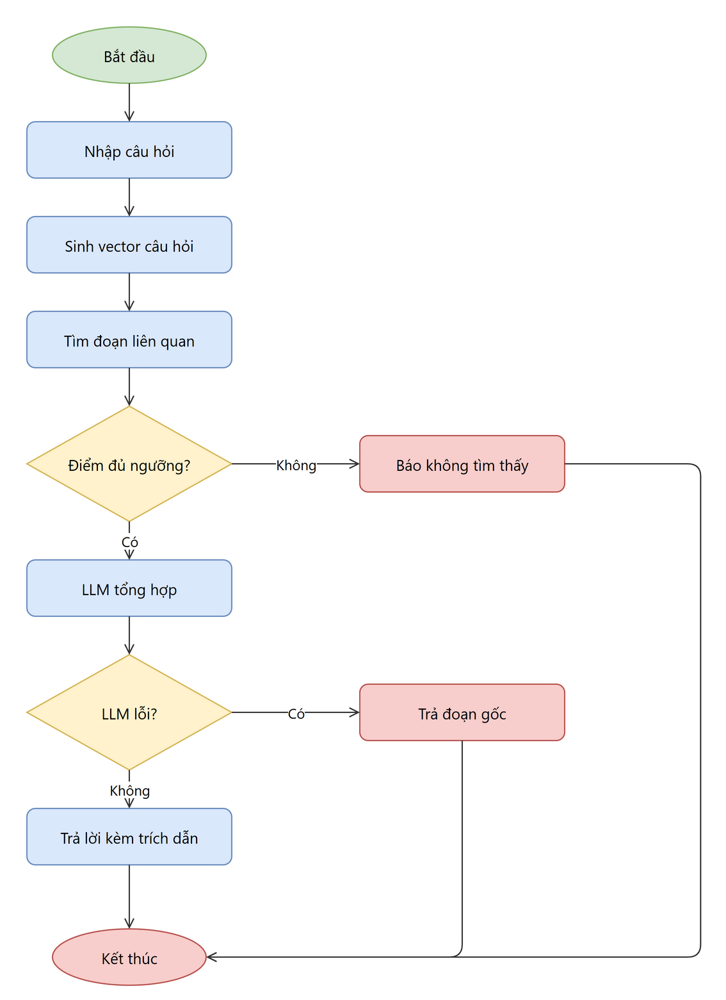

Bảng mô tả các bước chính:

| Bước | Hành động | Ghi chú |
|---|---|---|
| Nhập câu hỏi | Người dùng gửi câu hỏi | |
| Sinh vector | Sinh vector cho câu hỏi | tiền tố `query:` |
| Tìm đoạn liên quan | Truy vấn kho vector | lấy k đoạn gần nhất |
| Điểm đủ ngưỡng? | Rẽ nhánh lọc | dưới ngưỡng → báo không tìm thấy |
| Tổng hợp | Gọi mô hình ngôn ngữ | |
| Mô hình lỗi? | Rẽ nhánh | lỗi → trả đoạn gốc |
| Trả lời kèm trích dẫn | Đóng gói kết quả | |

### UC-04 – Nạp văn bản

**Hình 5-4. Sơ đồ hoạt động luồng nạp văn bản**

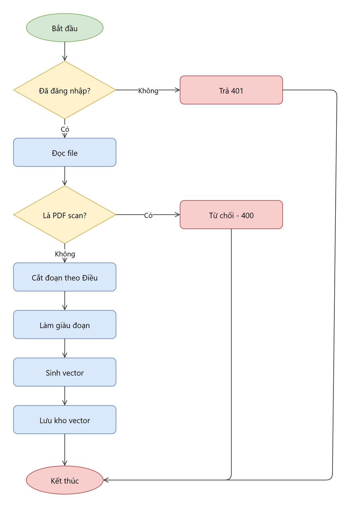

Bảng mô tả các bước chính:

| Bước | Hành động | Ghi chú |
|---|---|---|
| Đã đăng nhập? | Kiểm tra token | chưa → 401 |
| Đọc file | Trích text từ PDF/TXT | |
| Là PDF scan? | Kiểm tra text rỗng | scan → 400 |
| Cắt đoạn theo Điều | Chunker xử lý | |
| Làm giàu đoạn | Bước index tùy chọn | |
| Sinh vector | Embedding đoạn | prefix `passage:` |
| Lưu kho vector | Upsert vào ChromaDB | |

## 5.5 Sơ đồ tuần tự hệ thống

Sơ đồ tuần tự hệ thống (System Sequence Diagram – SSD) xem toàn bộ hệ thống như một hộp đen. Sơ đồ chỉ thể hiện thông điệp giữa tác nhân và hệ thống, chưa đi vào các lớp bên trong.

### UC-01 – Đặt câu hỏi tra cứu

**Hình 5-5. Sơ đồ tuần tự hệ thống cho luồng hỏi–đáp**

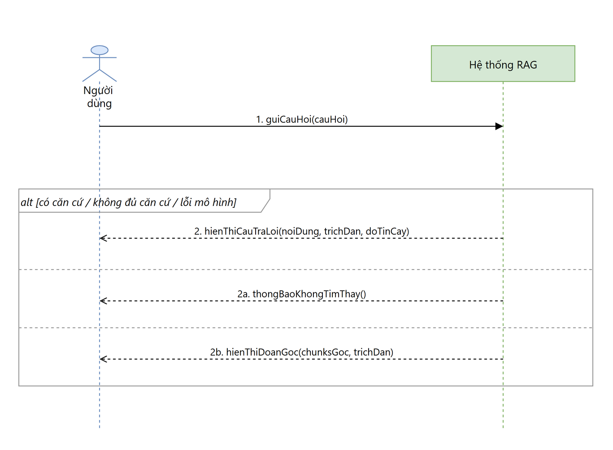

| Bước | Từ | Đến | Thông điệp | Kết quả |
|---:|---|---|---|---|
| 1 | Người dùng | Hệ thống RAG | `guiCauHoi(cauHoi)` | Hệ thống tiếp nhận câu hỏi |
| 2 | Hệ thống RAG | Người dùng | `hienThiCauTraLoi(...)` | Trả nội dung, trích dẫn và độ tin cậy |
| 2a | Hệ thống RAG | Người dùng | `thongBaoKhongTimThay()` | Không có căn cứ đủ liên quan |
| 2b | Hệ thống RAG | Người dùng | `hienThiDoanGoc(...)` | Mô hình lỗi, hệ thống trả đoạn gốc |

### UC-04 – Nạp văn bản

**Hình 5-6. Sơ đồ tuần tự hệ thống cho luồng nạp văn bản**

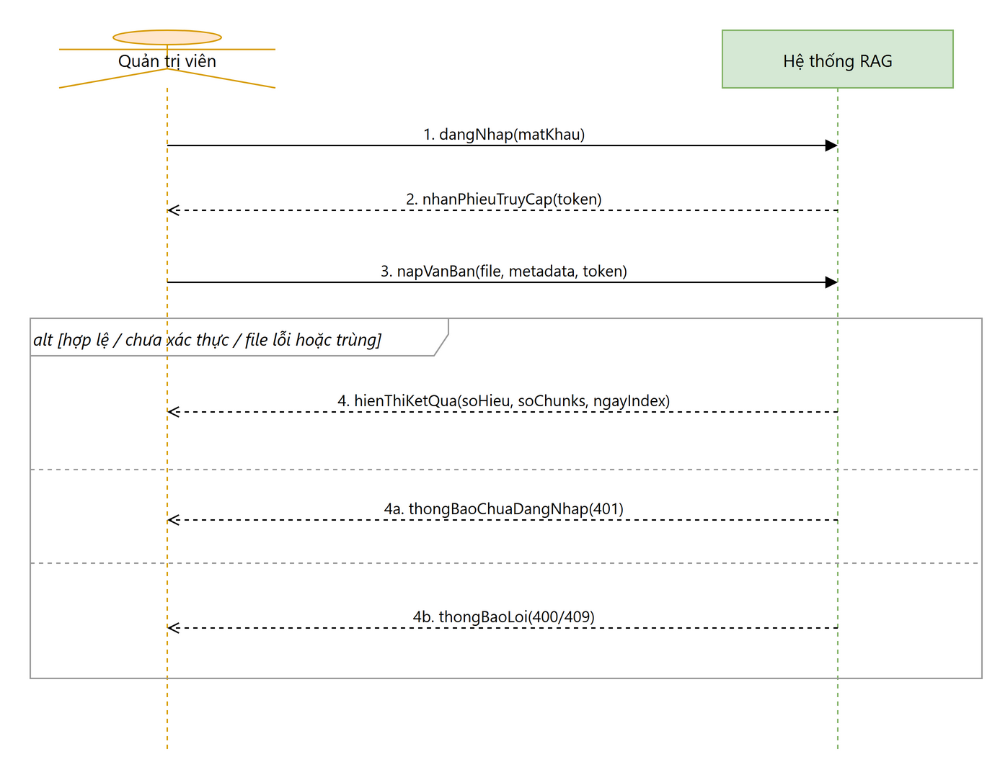

| Bước | Từ | Đến | Thông điệp | Kết quả |
|---:|---|---|---|---|
| 1 | Quản trị viên | Hệ thống RAG | `dangNhap(matKhau)` | Gửi mật khẩu xác thực |
| 2 | Hệ thống RAG | Quản trị viên | `nhanPhieuTruyCap(token)` | Cấp phiếu truy cập có hạn |
| 3 | Quản trị viên | Hệ thống RAG | `napVanBan(file, metadata, token)` | Gửi file và thông tin mô tả |
| 4 | Hệ thống RAG | Quản trị viên | `hienThiKetQua(...)` | Nạp thành công, trả số đoạn |
| 4a | Hệ thống RAG | Quản trị viên | `thongBaoChuaDangNhap(401)` | Thiếu/sai phiếu truy cập |
| 4b | Hệ thống RAG | Quản trị viên | `thongBaoLoi(400/409)` | File không hợp lệ hoặc trùng số hiệu |

Sơ đồ tuần tự chi tiết ở mục 7.6 tiếp tục mở hộp đen này để mô tả các thành phần nội bộ như route, pipeline, bộ sinh vector và kho dữ liệu.

---

# 6. KIẾN TRÚC PHẦN MỀM

## 6.1 Tổng quan kiến trúc

Hệ thống chia hai phần: **Frontend React** (giao diện chat và quản lý) và **Backend FastAPI** (API, các pipeline xử lý). Backend tổ chức theo kiến trúc phân tầng kết hợp mẫu module/plugin: phần lõi điều phối mỏng, còn thuật toán tìm kiếm và các bước xử lý được nạp động theo cấu hình.

## 6.2 Mẫu kiến trúc

Hệ thống sử dụng **kiến trúc phân tầng (Layered Architecture)** kết hợp **mẫu Strategy + Pipeline** cho phần truy hồi và xử lý câu hỏi.

### Lý do lựa chọn

Phân tầng giúp tách giao diện, điều phối và dữ liệu để dễ kiểm thử, bảo trì. Mẫu chiến lược (Strategy) cho phép đổi thuật toán tìm kiếm (vector hoặc lai – hybrid) bằng cấu hình khi module tương ứng đã được cài. Mẫu chuỗi xử lý (Pipeline) cho phép chèn thêm bước trước/sau (chuẩn hóa câu hỏi, kiểm chứng chéo, làm giàu dữ liệu) mà không sửa bộ điều phối.

## 6.3 Sơ đồ kiến trúc

**Hình 6-1. Kiến trúc phần mềm**

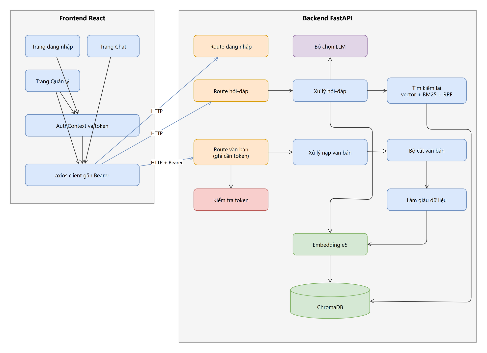

Bảng mô tả các thành phần trong sơ đồ kiến trúc:

| Thành phần | Vai trò |
|---|---|
| Trang Chat / Quản lý / Đăng nhập | Các màn hình frontend |
| AuthContext + axios client | Lưu token, gắn Bearer, xử lý 401 |
| Route đăng nhập / hỏi-đáp / văn bản | Các endpoint backend |
| Kiểm tra token | Chặn thao tác ghi khi thiếu token hợp lệ |
| Xử lý hỏi-đáp | Điều phối gating + tổng hợp |
| Tìm kiếm lai (vector + BM25 + RRF) | Chiến lược truy hồi lai, chọn qua cấu hình `RETRIEVAL_STRATEGY=hybrid` |
| Xử lý nạp văn bản / Bộ cắt / Làm giàu | Pipeline lập chỉ mục; làm giàu là bước index tùy chọn bật qua `INDEX_STEPS=enrich` |
| Embedding e5 / ChromaDB | Sinh vector và lưu trữ |
| Bộ chọn LLM | Chọn mô hình ngôn ngữ theo cấu hình |

## 6.4 Các tầng của hệ thống

### 6.4.1 Tầng giao diện

**Trách nhiệm:**

- Hiển thị chat, danh sách văn bản, form đăng nhập/nạp văn bản.
- Gọi API, gắn token, hiển thị markdown và trích dẫn.

### 6.4.2 Tầng ứng dụng / dịch vụ

**Trách nhiệm:**

- Cung cấp các điểm truy cập API (route) cho đăng nhập, hỏi–đáp, quản lý văn bản.
- Điều phối luồng xử lý (pipeline) hỏi–đáp và nạp văn bản.
- Xác thực admin cho thao tác ghi.

### 6.4.3 Tầng miền nghiệp vụ

**Trách nhiệm:**

- Chiến lược truy hồi (retrieval), lọc theo ngưỡng (gating), tổng hợp câu trả lời.
- Cắt văn bản theo Điều, sinh trích dẫn.

### 6.4.4 Tầng hạ tầng

**Trách nhiệm:**

- Kho vector ChromaDB (lưu đĩa).
- Mô hình sinh vector nhúng cục bộ.
- Kết nối dịch vụ mô hình ngôn ngữ bên ngoài.

## 6.5 Sơ đồ thành phần

**Hình 6-2. Sơ đồ thành phần**

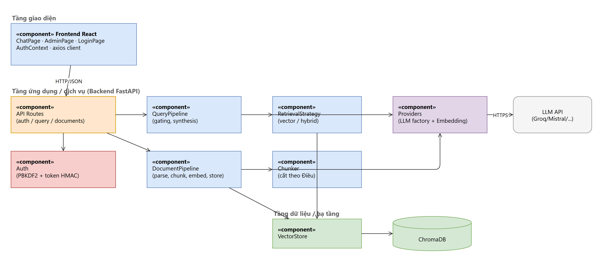

Bảng mô tả các thành phần (giao diện cung cấp – provided interface là các phương thức/điểm truy cập mà thành phần đó mở ra cho bên khác gọi):

| Thành phần | Giao diện cung cấp | Phụ thuộc |
|---|---|---|
| Frontend React | — | API Routes (HTTP/JSON) |
| API Routes (điểm truy cập) | Các điểm truy cập REST | QueryPipeline, DocumentPipeline, Auth |
| QueryPipeline | process_query | RetrievalStrategy, Providers |
| DocumentPipeline | process_document | Chunker, Providers, VectorStore |
| RetrievalStrategy | search | VectorStore |
| Chunker | chunk_document | — |
| Auth | require_admin, login | — |
| Providers | generate, embed | API mô hình ngôn ngữ (bên ngoài) |
| VectorStore | vector_search, add_chunks... | ChromaDB |

## 6.6 Cấu trúc module

| Module | Trách nhiệm | Phụ thuộc |
|---|---|---|
| api | Điểm truy cập (route), xác thực, bộ chứa phụ thuộc (DI container) | pipelines, storage, models |
| pipelines | Điều phối hỏi–đáp và nạp văn bản, các bước (step) | providers, retrieval, storage, chunking |
| retrieval | Chiến lược truy hồi (vector/lai – hybrid) | storage |
| storage | Kho vector ChromaDB (lưu trữ thuần) | chromadb |
| chunking | Cắt văn bản theo Điều | — |
| providers | Mô hình ngôn ngữ + sinh vector nhúng | thư viện groq/mistral/gemini... |
| prompts | Câu nhắc (prompt) tổng hợp | — |
| models | Cấu trúc dữ liệu (schema) yêu cầu/phản hồi | pydantic |
| config | Cấu hình từ .env | pydantic-settings |

---

# 7. THIẾT KẾ CHI TIẾT PHẦN MỀM

## 7.1 Tổng quan thiết kế

Các lớp điều khiển (control) ở mức phân tích được hiện thực thành `QueryPipeline` và `DocumentPipeline`; lớp thực thể kho vector thành `VectorStore`; lớp dịch vụ thành các bộ cung cấp (`LLMProvider`, `EmbeddingProvider`). Chiến lược truy hồi và các bước xử lý được trừu tượng hóa qua giao diện chung (interface) để nạp động theo cấu hình.

## 7.2 Sơ đồ lớp thiết kế

**Hình 7-1. Sơ đồ lớp thiết kế**

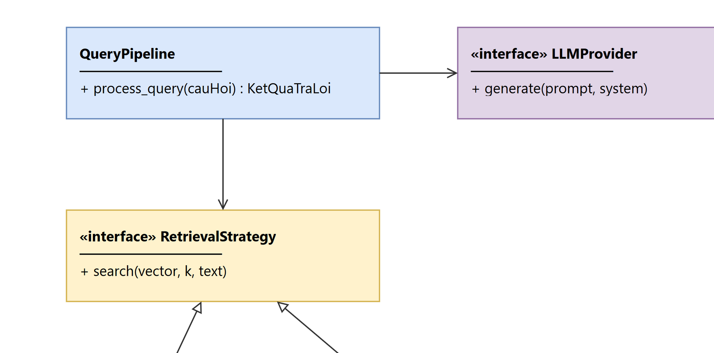

Bảng mô tả các lớp trong sơ đồ:

| Lớp | Vai trò |
|---|---|
| QueryPipeline | Điều phối xử lý câu hỏi |
| DocumentPipeline | Điều phối lập chỉ mục văn bản |
| RetrievalStrategy (giao diện – interface) | Trừu tượng hóa chiến lược truy hồi |
| VectorStrategy / HybridStrategy | VectorStrategy tìm theo cosine; HybridStrategy tìm lai vector + BM25 + RRF |
| VectorStore | Lưu và truy vấn vector trên ChromaDB |
| Chunker | Cắt văn bản theo Điều |
| EnrichStep | Bước làm giàu lúc lập chỉ mục (bật qua `INDEX_STEPS=enrich`) |
| LLMProvider (giao diện – interface) | Trừu tượng hóa mô hình ngôn ngữ |

## 7.3 Đặc tả lớp

### 7.3.1 QueryPipeline

**Mục đích:** Điều phối luồng xử lý câu hỏi (sinh vector → truy hồi → lọc ngưỡng → tổng hợp → đóng gói); phần xử lý có thể thay đổi nằm trong chiến lược (strategy) và các bước mở rộng (step).

#### Thuộc tính

| Thuộc tính | Kiểu | Phạm vi | Mô tả |
|---|---|---|---|
| _llm | LLMProvider | private | Mô hình ngôn ngữ tổng hợp |
| _embedding | EmbeddingProvider | private | Sinh vector câu hỏi |
| _retrieval | RetrievalStrategy | private | Chiến lược truy hồi |
| _settings | Settings | private | Cấu hình (ngưỡng, số đoạn lấy về...) |
| _steps | list[QueryStep] | private | Các bước chạy trước/sau truy hồi |

#### Phương thức

| Phương thức | Tham số | Kiểu trả về | Mô tả |
|---|---|---|---|
| process_query | cau_hoi: str | KetQuaTraLoi | Luồng chính xử lý câu hỏi |
| _answer | cau_hoi, results | KetQuaTraLoi | Lọc ngưỡng + tổng hợp + dự phòng |
| _calc_confidence | max_score: float | str | Suy nhãn độ tin cậy |
| _build_synthesis_prompt | cau_hoi, results | str | Dựng câu nhắc (prompt) đánh số đoạn |
| _build_citations | results | list[TrichDan] | Tạo trích dẫn |
| _dedupe_results | results | list[SearchResult] | Gộp mảnh cùng Điều |
| _fallback | results, do_tin_cay | KetQuaTraLoi | Trả đoạn gốc khi lỗi |

**Quan hệ:** phụ thuộc `LLMProvider`, `EmbeddingProvider`, `RetrievalStrategy`, `QueryStep`, `Settings`.

### 7.3.2 DocumentPipeline

**Mục đích:** Lập chỉ mục văn bản theo chuỗi bước: đọc nội dung (parse) → cắt đoạn (chunk) → làm giàu (nếu có) → sinh vector (embed) → lưu kho (store).

#### Thuộc tính

| Thuộc tính | Kiểu | Phạm vi | Mô tả |
|---|---|---|---|
| _embedding | EmbeddingProvider | private | Sinh vector đoạn |
| _store | VectorStore | private | Kho vector |
| _chunker | VietnameseLawChunker | private | Bộ cắt văn bản |
| _index_steps | list[IndexStep] | private | Bước lập chỉ mục (tùy chọn) |

#### Phương thức

| Phương thức | Tham số | Kiểu trả về | Mô tả |
|---|---|---|---|
| process_document | file_content, filename, metadata, replace | IndexingResult | Toàn bộ pipeline nạp |
| _parse | content, ext | str | Đọc text từ file |
| _parse_pdf | content | str | Trích text PDF (PyMuPDF) |

**Quan hệ:** dùng `Chunker`, `EmbeddingProvider`, `VectorStore`, `IndexStep`; ném `DocumentPipelineError`, `DuplicateDocumentError`.

### 7.3.3 VectorStore

**Mục đích:** Lưu trữ và truy vấn vector trên ChromaDB; lớp này chỉ phụ trách lưu trữ (storage), không chứa quy tắc nghiệp vụ.

#### Phương thức

| Phương thức | Tham số | Kiểu trả về | Mô tả |
|---|---|---|---|
| vector_search | query_vector, k | list[SearchResult] | Lấy k kết quả gần nhất theo cosine |
| add_chunks | chunks, vectors | None | Thêm mới hoặc cập nhật (upsert) đoạn và vector |
| get_corpus | — | tuple(ids, docs, metas) | Lấy toàn bộ tập dữ liệu (corpus) cho BM25 |
| cosine_for_ids | ids, query_vector | dict[str,float] | Cosine của các id chỉ định |
| delete_by_so_hieu | so_hieu | int | Xóa mọi đoạn của văn bản |
| update_document_metadata | so_hieu, updates | int | Cập nhật metadata, giữ vector |
| exists | so_hieu | bool | Kiểm tra tồn tại |
| list_documents | page, page_size | PaginatedResult | Liệt kê theo trang |
| count | — | int | Đếm số đoạn |

### 7.3.4 VietnameseLawChunker

**Mục đích:** Cắt văn bản luật thành đoạn theo đơn vị Điều.

#### Thuộc tính

| Thuộc tính | Kiểu | Mô tả |
|---|---|---|
| chunk_size | int | Kích thước đoạn mục tiêu (1200) |
| chunk_overlap | int | Độ chồng lấp khi cắt nhỏ (150) |
| max_chunk_size | int | Ngưỡng buộc cắt nhỏ (1800) |

#### Phương thức

| Phương thức | Tham số | Kiểu trả về | Mô tả |
|---|---|---|---|
| chunk_document | text, base_metadata | list[Chunk] | Cắt theo Điều; nếu không có Điều thì cắt theo kích thước (fallback) |

### 7.3.5 Các lớp cung cấp mô hình (Provider)

| Lớp | Kiểu / lớp cha | Thuộc tính hoặc phương thức chính | Mục đích |
|---|---|---|---|
| LLMResponse | dataclass | content: str | Gói nội dung trả về thống nhất từ mọi mô hình |
| LLMProvider | ABC (giao diện trừu tượng) | generate(prompt, system_prompt) | Quy định giao diện chung cho mô hình ngôn ngữ |
| EmbeddingProvider | ABC | embed_text, embed_batch, get_dimension | Quy định giao diện chung để sinh vector |
| GroqProvider | LLMProvider | model, timeout, max_tokens, reasoning_effort | Gọi Groq; nhiệt độ (temperature) 0.2 |
| MistralProvider | LLMProvider | model, timeout, max_tokens | Gọi Mistral Chat API; nhiệt độ 0.2 |
| CohereProvider | LLMProvider | model, timeout, max_tokens | Gọi Cohere Chat API v2; ghép các khối nội dung trả về |
| GeminiProvider | LLMProvider | model, timeout | Gọi Gemini; nhiệt độ 0.1 |
| OllamaProvider | LLMProvider | model, base_url, timeout, think | Gọi mô hình cục bộ qua Ollama; có thể tắt suy luận để chạy nhanh hơn |
| HuggingFaceEmbedding | EmbeddingProvider | model, embed_text, embed_batch, get_dimension | Sinh vector e5-large 1024 chiều; dùng tiền tố `query:` và `passage:` |

### 7.3.6 Các lớp truy hồi

| Lớp | Thuộc tính chính | Phương thức | Mục đích |
|---|---|---|---|
| RetrievalStrategy | — | search(query_vector, k, query_text) | Giao diện trừu tượng cho mọi chiến lược truy hồi |
| VectorStrategy | _store: VectorStore | search(...) | Gọi tìm kiếm vector theo độ tương đồng cosine |
| HybridStrategy | _store, _bm25, _data_version | search(...) | Tìm lai: gộp xếp hạng vector và BM25 bằng RRF |

`HybridStrategy` hiện thực tìm kiếm lai vector + BM25 + RRF. Chọn chiến lược qua `RETRIEVAL_STRATEGY` trong `.env` (`vector` hoặc `hybrid`); hàm `load_strategy(name, store)` nạp động lớp tương ứng lúc khởi động. BM25 (Okapi, k1=1.5, b=0.75) và RRF (k=60) nằm trong chính `hybrid_strategy.py`; RRF chỉ dùng để xếp hạng, còn điểm trả về vẫn là cosine để không phá ngưỡng lọc (gating).

### 7.3.7 Các lớp ngữ cảnh và bước mở rộng

| Lớp | Thuộc tính chính | Phương thức | Mục đích |
|---|---|---|---|
| QueryContext | cau_hoi, query_vector, results, ket_qua, short_circuit | — | Chứa trạng thái đi xuyên suốt luồng hỏi–đáp |
| StepDeps | settings, primary_llm, embedding, store, verify_llm | — | Gom các phụ thuộc cấp cho bước xử lý câu hỏi |
| QueryStep | name | before_retrieval, after_answer | Giao diện cho bước chạy trước truy hồi hoặc sau trả lời |
| BaseStep | name="base" | before_retrieval, after_answer | Lớp cơ sở với hai phương thức mặc định không làm gì |
| IndexContext | chunks, embed_texts | — | Giữ đoạn gốc và phần chữ dùng để sinh vector |
| IndexDeps | settings, primary_llm, embedding | — | Gom các phụ thuộc cấp cho bước lập chỉ mục |
| IndexStep | name | process(ctx) | Giao diện cho bước chạy giữa cắt đoạn và sinh vector |
| BaseIndexStep | name="base" | process(ctx) | Lớp cơ sở cho bước lập chỉ mục |

Các bước cụ thể được nạp khi tên module có trong cấu hình (`QUERY_STEPS` / `INDEX_STEPS`); step bật nhưng không có tệp sẽ được bỏ qua (ghi WARN). Bước làm giàu `EnrichStep` (`indexing/enrich_step.py`) và bộ nhập/xuất `enrich_io.py` đã có sẵn; các bước chuẩn hóa câu không dấu và kiểm chứng chéo là hướng mở rộng (xem mục 16.6).

### 7.3.8 Các lớp dữ liệu và schema

| Lớp | Trường chính | Vai trò |
|---|---|---|
| ChunkMetadata | soHieu, tenVanBan, dieu, khoan, muc, ngày, cơ quan, loại | Thông tin pháp lý gắn với mỗi đoạn |
| Chunk | text, metadata | Một đoạn văn bản luật |
| DocumentMetadata | soHieu, tenVanBan, ngày, cơ quan, loại | Thông tin đầu vào cho bộ cắt |
| SearchResult | id, text, metadata, score | Một kết quả truy hồi |
| PaginatedResult | items, total, page, page_size | Kết quả danh sách có phân trang |
| QueryRequest | cauHoi | Dữ liệu yêu cầu hỏi–đáp |
| DocumentMetadataInput | soHieu, tenVanBan, ngày, cơ quan, loại | Dữ liệu nạp văn bản |
| DocumentUpdateInput | các trường metadata tùy chọn | Dữ liệu sửa văn bản |
| IndexingResult | soHieu, tenVanBan, soChunks, ngayIndex | Kết quả lập chỉ mục |
| TrichDan | soHieu, tenVanBan, dieu, khoan, noiDungDayDu | Nguồn pháp lý của câu trả lời |
| KetQuaTraLoi | noiDung, trichDan, doTinCay, chunksGoc | Kết quả trả cho người dùng |
| LoginRequest | password | Yêu cầu đăng nhập admin |
| LoginResponse | token, role, expiresIn | Kết quả đăng nhập |
| Message | id, role, content, ketQua, timestamp | Một tin nhắn người dùng hoặc hệ thống ở frontend |
| ChatSession | id, title, messages, createdAt, updatedAt | Một cuộc trò chuyện lưu trong trình duyệt |

### 7.3.9 Lớp cấu hình và lỗi

| Lớp | Thuộc tính/phương thức chính | Mục đích |
|---|---|---|
| LLMChoice | kind, model, api_key, base_url, timeout, max_tokens | Cấu hình đã phân giải cho một nhà cung cấp mô hình |
| Settings | cấu hình LLM, auth, embedding, ChromaDB, ngưỡng, logging | Đọc `.env`, cung cấp cấu hình tập trung |
| DocumentPipelineError | thông báo lỗi | Biểu diễn lỗi định dạng, kích thước hoặc đọc văn bản |
| DuplicateDocumentError | so_hieu | Biểu diễn lỗi văn bản trùng số hiệu |

Hàm `llm_factory` dùng `Settings.resolve_llm()` để tạo đúng lớp provider. Các hàm xác thực trong `api/auth.py` chịu trách nhiệm băm/kiểm tra mật khẩu và tạo/kiểm tra phiếu truy cập HMAC.

### 7.3.10 Thành phần quản lý lịch sử trò chuyện ở frontend

| Thành phần | Thuộc tính / hàm chính | Mục đích |
|---|---|---|
| `useChatSessions` | sessions, currentId, messages, loading | Hook React quản lý toàn bộ trạng thái trò chuyện |
| `newSession` | — | Tạo cuộc trò chuyện mới, bỏ cuộc rỗng cũ |
| `switchSession` | id | Chuyển sang cuộc trò chuyện được chọn |
| `deleteSession` | id | Xóa cuộc trò chuyện |
| `sendQuery` | cauHoi | Thêm tin nhắn người dùng, gọi `/api/query`, thêm câu trả lời |
| `ChatSidebar` | sessions, currentId, collapsed, callbacks | Hiển thị thanh lịch sử và nhận thao tác người dùng |
| `loadSessions` | — | Đọc lịch sử từ `localStorage`; lỗi thì trả mảng rỗng |
| `saveSessions` | sessions | Chỉ lưu tối đa 50 cuộc gần nhất |

## 7.4 Thiết kế giao diện lập trình (Interface)

### RetrievalStrategy

**Mục đích:** Trừu tượng chiến lược truy hồi để đổi thuật toán qua cấu hình.

| Phương thức | Tham số | Kiểu trả về | Mô tả |
|---|---|---|---|
| search | query_vector, k, query_text | list[SearchResult] | Trả top-k đoạn liên quan |

### QueryStep (Protocol)

**Mục đích:** Bước xử lý chèn vào trước/sau truy hồi.

| Phương thức | Tham số | Kiểu trả về | Mô tả |
|---|---|---|---|
| before_retrieval | ctx: QueryContext | None | Xử lý trước truy hồi (vd chuẩn hóa) |
| after_answer | ctx: QueryContext | None | Xử lý sau khi có câu trả lời (vd kiểm chứng) |

### LLMProvider / EmbeddingProvider

Đã mô tả ở mục 7.3.5.

## 7.5 Mẫu thiết kế (Design Pattern)

**Hình 7-2. Các mẫu thiết kế chính được áp dụng**

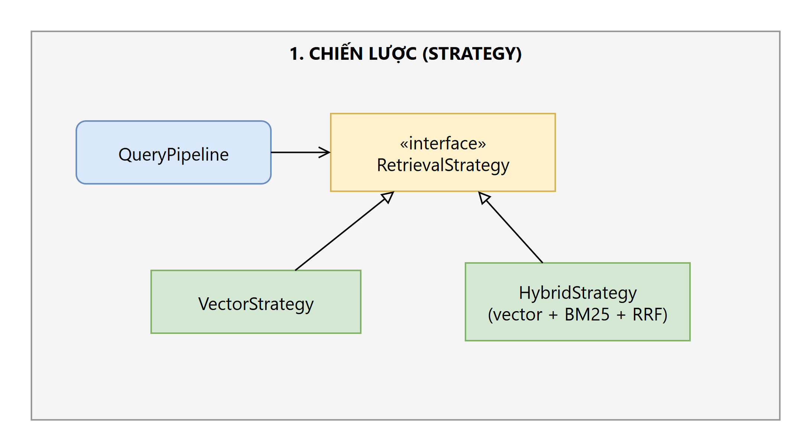

| Mẫu | Thành phần tham gia | Mục đích |
|---|---|---|
| Chiến lược (Strategy) | QueryPipeline, RetrievalStrategy, VectorStrategy, HybridStrategy | Đổi cách truy hồi mà không sửa bộ điều phối |
| Chuỗi xử lý (Pipeline) | QueryStep, IndexStep, QueryPipeline, DocumentPipeline | Chèn bước mở rộng trước/sau xử lý lõi |
| Khởi tạo (Factory) | Settings, llm_factory, các LLMProvider | Chọn nhà cung cấp mô hình theo cấu hình |
| Tiêm phụ thuộc (Dependency Injection) | FastAPI lifespan, DI container, API routes | Khởi tạo một lần và cấp đúng phụ thuộc cho route |

### 7.5.1 Chiến lược (Strategy) cho truy hồi

**Mẫu (Pattern):** Strategy.

**Vấn đề:** Cần đổi thuật toán tìm kiếm (vector thuần ↔ lai vector+BM25) mà không sửa phần điều phối.

**Giải pháp:** Định nghĩa giao diện `RetrievalStrategy`; `VectorStrategy` và `HybridStrategy` là hai hiện thực. Hàm `load_strategy(name, store)` nạp lớp theo cấu hình lúc khởi động.

**Các thành phần tham gia:** `RetrievalStrategy` (giao diện – interface), `VectorStrategy`, `HybridStrategy`, `QueryPipeline` (lớp sử dụng – client).

**Cách triển khai:** `QueryPipeline` chỉ gọi `self._retrieval.search(...)`, không biết thuật toán cụ thể; chọn lớp qua `RETRIEVAL_STRATEGY` trong `.env`.

**Lợi ích:** Đổi thuật toán qua cấu hình; dễ kiểm thử từng chiến lược riêng.

**Đánh đổi:** Thêm một lớp trừu tượng; mỗi chiến lược phải tự đảm bảo ý nghĩa điểm số nhất quán.

**Yêu cầu liên quan:** FR-01. **Use Case liên quan:** UC-01.

### 7.5.2 Chuỗi xử lý (Pipeline) và bước mở rộng (Step)

**Mẫu (Pattern):** Pipeline (chuỗi bước) + Hook.

**Vấn đề:** Muốn chèn thêm bước (chuẩn hóa câu hỏi, kiểm chứng chéo, làm giàu) mà không sửa lõi.

**Giải pháp:** `QueryStep` với hook `before_retrieval` / `after_answer`; `IndexStep` với `process`; nạp động theo `QUERY_STEPS` / `INDEX_STEPS`.

**Các thành phần tham gia:** QueryStep, IndexStep, QueryPipeline, DocumentPipeline, load_steps.

**Cách triển khai:** Pipeline lặp qua danh sách step và gọi hook; step vắng file thì bỏ qua (WARN).

**Lợi ích:** Mở rộng chức năng không đụng lõi; bật/tắt qua cấu hình.

**Đánh đổi:** Luồng khó theo dõi hơn khi nhiều step.

**Yêu cầu liên quan:** FR-01, FR-05. **Use Case liên quan:** UC-01, UC-04.

### 7.5.3 Mẫu khởi tạo (Factory) để chọn mô hình ngôn ngữ

**Mẫu (Pattern):** Factory.

**Vấn đề:** Cần chọn một trong nhiều nhà cung cấp mô hình (Groq/Mistral/Cohere/Gemini/Ollama) theo cấu hình.

**Giải pháp:** `resolve_llm(provider)` trả `LLMChoice`; factory `_build(choice)` tạo provider tương ứng.

**Các thành phần tham gia:** Settings, LLMChoice, llm_factory, các LLMProvider cụ thể.

**Cách triển khai:** Điền tên provider vào `PRIMARY_LLM_PROVIDER`; key/model lấy từ catalog trong `.env`.

**Lợi ích:** Đổi mô hình không sửa mã; thử nghiệm nhiều nhà cung cấp dễ dàng.

**Đánh đổi:** Phải chuẩn hóa giao diện `generate` giữa các nhà cung cấp khác nhau.

**Yêu cầu liên quan:** FR-01. **Use Case liên quan:** UC-01.

### 7.5.4 Tiêm phụ thuộc (Dependency Injection)

**Mẫu (Pattern):** Dependency Injection (qua container DI của FastAPI).

**Vấn đề:** Route cần dùng pipeline/store nhưng không nên tự khởi tạo.

**Giải pháp:** Khởi tạo singleton lúc startup, cung cấp qua `Depends(...)`.

**Lợi ích:** Giảm phụ thuộc cứng, dễ thay bằng bản giả khi kiểm thử.

**Đánh đổi:** Cần quản lý vòng đời singleton ở lifespan.

## 7.6 Sơ đồ tuần tự

### UC-01 – Đặt câu hỏi tra cứu

**Hình 7-3. Sơ đồ tuần tự luồng hỏi–đáp**

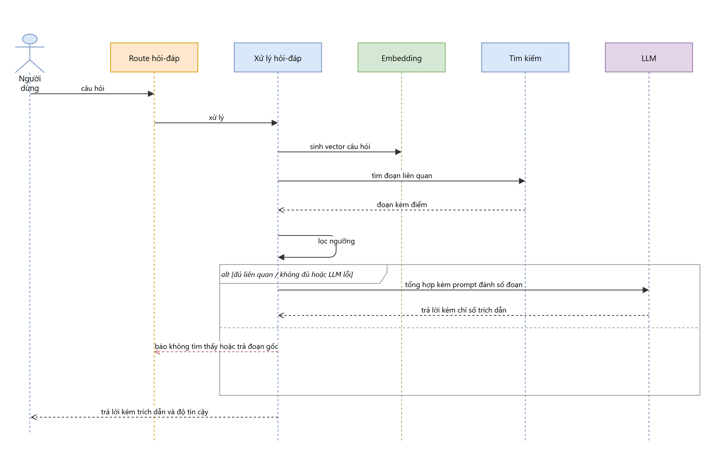

Bảng mô tả tương tác:

| Bước | Từ | Đến | Thông điệp / xử lý |
|---:|---|---|---|
| 1 | Người dùng | Route hỏi–đáp | Gửi câu hỏi |
| 2 | Route hỏi–đáp | QueryPipeline | Yêu cầu xử lý câu hỏi |
| 3 | QueryPipeline | EmbeddingProvider | Sinh vector câu hỏi |
| 4 | QueryPipeline | RetrievalStrategy | Tìm các đoạn liên quan kèm điểm |
| 5 | QueryPipeline | LLMProvider | Tổng hợp khi điểm đủ ngưỡng |
| 6 | QueryPipeline | Người dùng | Trả nội dung, trích dẫn và độ tin cậy; lỗi mô hình thì trả đoạn gốc |

### UC-04 – Nạp văn bản

**Hình 7-4. Sơ đồ tuần tự luồng nạp văn bản**

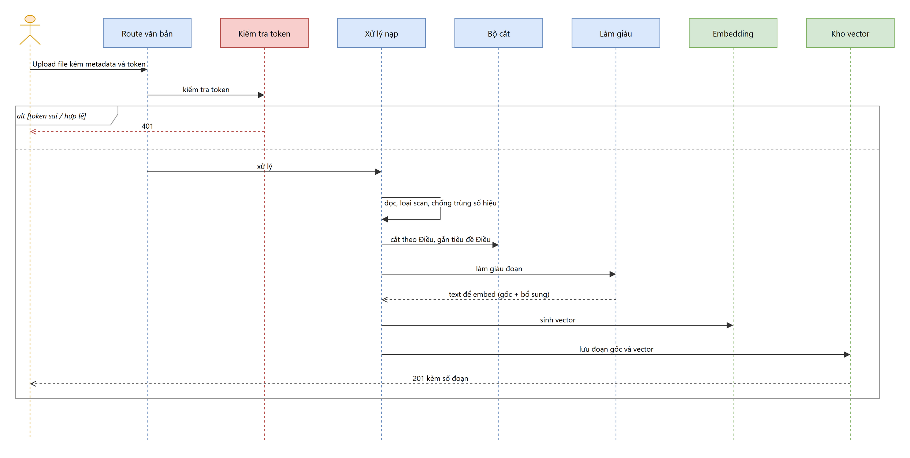

Bảng mô tả tương tác:

| Bước | Từ | Đến | Thông điệp / xử lý |
|---:|---|---|---|
| 1 | Quản trị viên | Route văn bản | Tải tệp, metadata và phiếu truy cập lên |
| 2 | Route văn bản | Bộ kiểm tra token | Kiểm tra quyền admin |
| 3 | Route văn bản | DocumentPipeline | Chuyển yêu cầu nạp văn bản |
| 4 | DocumentPipeline | Chunker | Đọc tệp và cắt theo Điều |
| 5 | DocumentPipeline | EmbeddingProvider | Sinh vector cho các đoạn |
| 6 | DocumentPipeline | VectorStore | Lưu đoạn gốc, metadata và vector |
| 7 | VectorStore | Quản trị viên | Trả số đoạn đã lập chỉ mục |

### UC-03 – Đăng nhập admin

**Hình 7-5. Sơ đồ tuần tự đăng nhập admin**

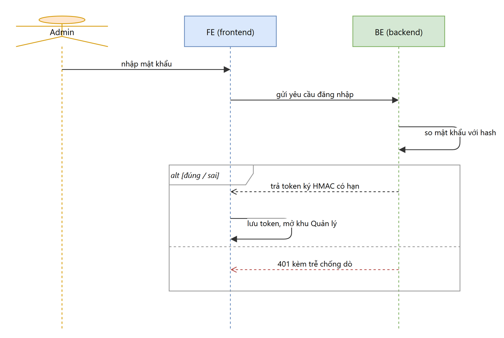

Bảng mô tả tương tác:

| Bước | Từ | Đến | Thông điệp / xử lý |
|---:|---|---|---|
| 1 | Quản trị viên | Frontend | Nhập mật khẩu |
| 2 | Frontend | Route đăng nhập | Gửi yêu cầu đăng nhập |
| 3 | Route đăng nhập | Auth | So mật khẩu với chuỗi băm |
| 4a | Auth | Frontend | Đúng: trả phiếu truy cập HMAC có hạn |
| 4b | Auth | Frontend | Sai: chờ 1 giây rồi trả 401 |
| 5 | Frontend | Quản trị viên | Lưu phiếu và mở khu quản lý |

## 7.7 Sơ đồ trạng thái

### Văn bản pháp luật

**Hình 7-6. Sơ đồ trạng thái vòng đời văn bản**

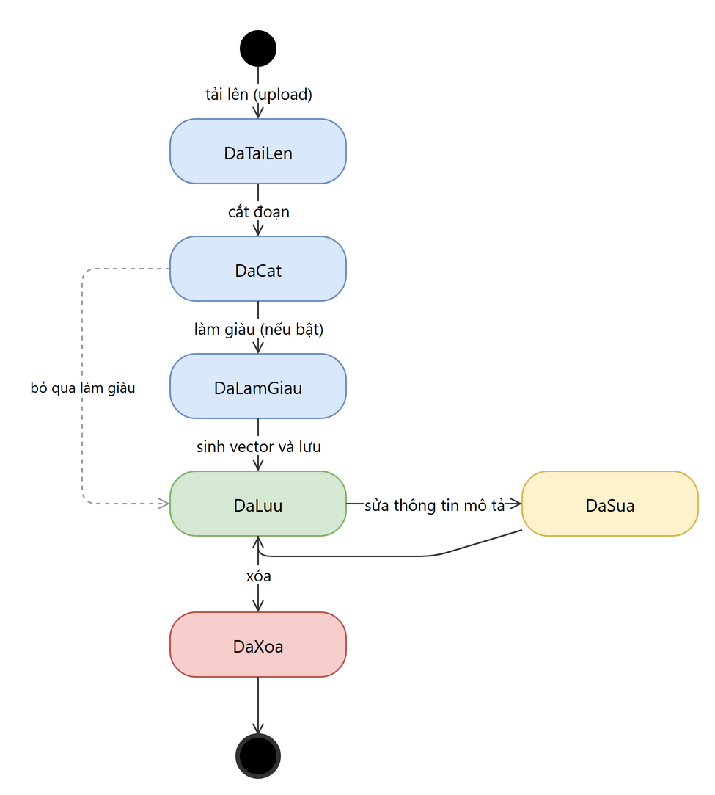

Bảng mô tả trạng thái:

| Trạng thái | Mô tả |
|---|---|
| DaTaiLen | Vừa tải lên (upload), chưa xử lý |
| DaCat | Đã cắt thành các đoạn theo Điều; có thể đi thẳng đến DaLuu nếu không bật làm giàu |
| DaLamGiau | Đã qua bước làm giàu tùy chọn |
| DaLuu | Đã sinh vector và lưu kho (sẵn sàng tra cứu) |
| DaSua | Thông tin mô tả (metadata) được cập nhật, sau đó quay lại DaLuu |
| DaXoa | Đã xóa khỏi kho |

---

# 8. THIẾT KẾ DỮ LIỆU

## 8.1 Mô hình dữ liệu

Dữ liệu lưu trong ChromaDB dưới dạng collection `luat_giao_thong`, mỗi bản ghi là một đoạn văn bản gồm: id, nội dung (document), vector nhúng, và metadata phẳng. Không dùng cơ sở dữ liệu quan hệ.

## 8.2 Sơ đồ ERD

**Hình 8-1. Sơ đồ thực thể - liên kết**

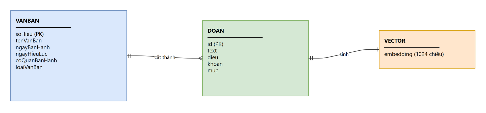

Bảng mô tả thực thể:

| Thực thể | Thuộc tính | Ghi chú |
|---|---|---|
| VANBAN | soHieu (PK), tenVanBan, ngày ban hành/hiệu lực, cơ quan, loại | Một văn bản |
| DOAN | id (PK), text, dieu, khoan, muc | Một Điều/đoạn của văn bản |
| VECTOR | embedding (1024 chiều) | Vector nhúng được lưu cùng đoạn; điểm tương đồng chỉ được tính khi truy vấn, không lưu trong bản ghi |

## 8.3 Thiết kế cơ sở dữ liệu

ChromaDB không có bảng quan hệ; mỗi bản ghi đoạn gồm các trường sau (metadata phẳng):

### Bản ghi đoạn (collection `luat_giao_thong`)

| Trường | Kiểu | Ràng buộc | Mô tả |
|---|---|---|---|
| id | string | PK | Định danh, dạng `{soHieu}__dieu_{N}` (mảnh thêm `__{k}`) |
| document | text | NOT NULL | Nội dung đoạn (hiển thị + trích dẫn) |
| embedding | float[1024] | NOT NULL | Vector nhúng (cosine) |
| soHieu | string | NOT NULL | Số hiệu văn bản |
| tenVanBan | string | | Tên văn bản |
| dieu | string | | Điều (vd "Điều 7") |
| khoan | string | | Danh sách khoản, nối bằng dấu phẩy |
| muc | string | | Danh sách điểm (a/b/c), nối bằng dấu phẩy |
| ngayBanHanh | string | | Ngày ban hành (ISO) |
| ngayHieuLuc | string | | Ngày hiệu lực (ISO) |
| coQuanBanHanh | string | | Cơ quan ban hành |
| loaiVanBan | string | | Loại văn bản |

### Dữ liệu lịch sử trò chuyện (`localStorage`)

Frontend lưu JSON tại khóa `rag-gt-chat-sessions`; dữ liệu không nằm trong ChromaDB và không đồng bộ giữa các trình duyệt.

| Trường | Kiểu | Ràng buộc | Mô tả |
|---|---|---|---|
| sessions | ChatSession[] | tối đa 50 cuộc có tin nhắn | Danh sách cuộc trò chuyện gần nhất |
| session.id | string (UUID) | duy nhất | Mã cuộc trò chuyện |
| session.title | string | tối đa 60 ký tự từ câu hỏi đầu | Tiêu đề hiển thị |
| session.messages | Message[] | tối đa 100 tin nhắn | Nội dung cuộc trò chuyện |
| session.createdAt | number | timestamp | Thời điểm tạo |
| session.updatedAt | number | timestamp | Thời điểm cập nhật |
| message.id | string (UUID) | duy nhất trong phiên | Mã tin nhắn |
| message.role | user / assistant | bắt buộc | Bên gửi tin nhắn |
| message.content | string | bắt buộc | Nội dung hiển thị |
| message.ketQua | KetQuaTraLoi | tùy chọn | Kết quả đầy đủ khi là câu trả lời |
| message.timestamp | number | timestamp | Thời điểm gửi |

## 8.4 Từ điển dữ liệu

| Entity | Thuộc tính | Kiểu | Mô tả |
|---|---|---|---|
| Đoạn | id | string | Định danh đoạn |
| Đoạn | soHieu | string | Số hiệu văn bản nguồn |
| Đoạn | dieu | string | Điều luật |
| Đoạn | khoan | string | Các khoản trong đoạn |
| Câu hỏi | cauHoi | string | Nội dung câu hỏi (1–1000 ký tự) |
| Câu trả lời | noiDung | string (markdown) | Nội dung tổng hợp |
| Câu trả lời | doTinCay | string | cao / trung bình / thấp |
| Trích dẫn | noiDungDayDu | string | Nội dung đoạn được dẫn |
| Cuộc trò chuyện | id, title | string | Mã và tiêu đề lịch sử chat |
| Cuộc trò chuyện | createdAt, updatedAt | number | Thời gian tạo/cập nhật dạng timestamp |
| Tin nhắn | role, content | string | Vai trò bên gửi và nội dung |
| Tin nhắn | ketQua | KetQuaTraLoi? | Kết quả RAG đi kèm tin nhắn trả lời |

## 8.5 Kiểm tra và ràng buộc dữ liệu

- Câu hỏi: 1–1000 ký tự (kiểm bằng pydantic).
- File nạp: ≤ 50MB, định dạng pdf/txt.
- Không trùng số hiệu (kiểm `exists` trước khi nạp).
- Metadata phẳng: danh sách khoản/mục lưu dạng chuỗi nối dấu phẩy (giới hạn của ChromaDB).
- Lịch sử trò chuyện: chỉ lưu cuộc có tin nhắn; cắt còn 50 cuộc gần nhất và 100 tin nhắn gần nhất mỗi cuộc; dữ liệu JSON lỗi được bỏ qua an toàn.

---

# 9. THIẾT KẾ GIAO DIỆN

## 9.1 Giao diện người dùng

Bảng tóm tắt các màn hình chính:

| Màn hình | Thành phần | Mục đích |
|---|---|---|
| Trang Chat | Ô nhập câu hỏi, danh sách tin nhắn, chip trích dẫn, nhãn độ tin cậy | Tra cứu và đọc câu trả lời |
| Trang Quản lý | Biểu mẫu tải lên (form upload), bảng danh sách văn bản, nút sửa/xóa | Nạp và bảo trì kho văn bản |
| Trang Đăng nhập | Ô mật khẩu, nút đăng nhập | Xác thực admin |

### 9.1.1 Trang Chat

Màn hình chính cho người dùng tra cứu. Gồm ô nhập câu hỏi ở dưới, khung hội thoại hiển thị câu hỏi và câu trả lời dạng văn bản có định dạng (markdown), các chip trích dẫn bấm được để xem toàn văn điều khoản, và nhãn độ tin cậy (cao / trung bình / thấp) đi kèm mỗi câu trả lời.

**Hình 9-1. Giao diện Trang Chat**


### 9.1.2 Trang Quản lý

Màn hình dành cho admin (sau khi đăng nhập). Gồm biểu mẫu tải lên văn bản (chọn file PDF/TXT và nhập thông tin mô tả: số hiệu, tên, ngày ban hành/hiệu lực, cơ quan, loại), bảng liệt kê các văn bản đã nạp (số hiệu, tên, loại, số đoạn) kèm nút sửa và xóa cho từng dòng.

**Hình 9-2. Giao diện Trang Quản lý**


### 9.1.3 Trang Đăng nhập

Màn hình xác thực admin, gồm ô nhập mật khẩu và nút đăng nhập. Nhập đúng mật khẩu sẽ mở khu Quản lý; nhập sai hiển thị thông báo lỗi.

**Hình 9-3. Giao diện Trang Đăng nhập**


**Kiểm tra dữ liệu đầu vào:**

- Câu hỏi không rỗng, tối đa 1000 ký tự.
- File tải lên đúng định dạng và kích thước; thông tin mô tả (metadata) bắt buộc có số hiệu, tên, ngày.

## 9.2 Thiết kế API

Tất cả điểm truy cập (endpoint) nằm dưới tiền tố `/api`. Khi xác thực admin được cấu hình, thao tác ghi cần header `Authorization: Bearer <token>`. Môi trường triển khai thật bắt buộc phải bật cấu hình này; nếu `ADMIN_PASSWORD_HASH` trống, code hiện tại mở các route ghi để hỗ trợ phát triển.

### API: POST /api/query

**Mục đích:** Tra cứu luật giao thông.

**Xác thực:** Không.

#### Yêu cầu gửi lên (Request)

```text
POST /api/query
{ "cauHoi": "Vượt đèn đỏ bị phạt bao nhiêu?" }
```

#### Dữ liệu trả về (Response)

```text
200 OK
{
  "noiDung": "... (markdown, có [1][2])",
  "trichDan": [{ "soHieu": "...", "tenVanBan": "...", "dieu": "Điều 7", "khoan": "5", "noiDungDayDu": "..." }],
  "doTinCay": "cao",
  "chunksGoc": null
}
```

#### Mã trạng thái HTTP (HTTP Status Code)

| Status | Ý nghĩa |
|---|---|
| 200 | Thành công |
| 422 | Câu hỏi không hợp lệ (rỗng hoặc quá 1000 ký tự) |

### API: POST /api/documents

**Mục đích:** Nạp và lập chỉ mục văn bản.

**Xác thực:** Có (admin).

#### Yêu cầu gửi lên (Request)

```text
POST /api/documents   (multipart/form-data)
file: <PDF/TXT>
metadata: {"soHieu":"36/2024/QH15","tenVanBan":"...","ngayBanHanh":"2024-06-27","ngayHieuLuc":"2025-01-01","coQuanBanHanh":"Quốc hội","loaiVanBan":"Luật"}
enrich_mode: none | auto | manual   (tùy chọn; mặc định none)
enrich_file: <TXT>                   (bắt buộc khi enrich_mode=manual)
```

Tham số `enrich_mode` chọn cách làm giàu đoạn lúc nạp: `none` (mặc định, không làm giàu), `auto` (gọi LLM sinh câu hỏi đời thường gắn vào phần chữ để embed), hoặc `manual` (ghép dữ liệu làm giàu từ `enrich_file` dạng JSONL). Dù chế độ nào, nội dung đoạn gốc lưu trong kho vẫn giữ nguyên để trích dẫn sạch.

#### Dữ liệu trả về (Response)

```text
201 Created
{ "soHieu": "36/2024/QH15", "tenVanBan": "...", "soChunks": 120, "ngayIndex": "2026-08-24T10:00:00" }
```

#### Mã trạng thái HTTP (HTTP Status Code)

| Status | Ý nghĩa |
|---|---|
| 201 | Nạp thành công |
| 400 | Metadata/định dạng không hợp lệ hoặc PDF scan |
| 401 | Chưa đăng nhập admin |
| 409 | Trùng số hiệu |

### API: GET /api/documents

**Mục đích:** Liệt kê văn bản theo trang.

**Xác thực:** Không.

#### Yêu cầu gửi lên (Request)

```text
GET /api/documents?page=1&page_size=20
```

#### Dữ liệu trả về (Response)

```text
200 OK
{ "items": [{ "soHieu": "...", "tenVanBan": "...", "loaiVanBan": "...", "soChunks": 120 }], "total": 4, "page": 1, "page_size": 20 }
```

#### Mã trạng thái HTTP (HTTP Status Code)

| Status | Ý nghĩa |
|---|---|
| 200 | Thành công |

### API: PATCH /api/documents/{soHieu}

**Mục đích:** Sửa metadata văn bản (không nạp lại).

**Xác thực:** Có (admin).

#### Yêu cầu gửi lên (Request)

```text
PATCH /api/documents/36/2024/QH15
{ "tenVanBan": "Tên mới", "loaiVanBan": "Luật" }
```

#### Dữ liệu trả về (Response)

```text
200 OK
{ "message": "Đã cập nhật 120 chunks.", "soHieu": "36/2024/QH15" }
```

#### Mã trạng thái HTTP (HTTP Status Code)

| Status | Ý nghĩa |
|---|---|
| 200 | Cập nhật thành công |
| 400 | Không có trường để cập nhật / số hiệu rỗng |
| 401 | Chưa đăng nhập admin |
| 404 | Không tìm thấy văn bản |
| 409 | Số hiệu mới đã tồn tại |

### API: DELETE /api/documents/{soHieu}

**Mục đích:** Xóa văn bản theo số hiệu.

**Xác thực:** Có (admin).

#### Dữ liệu trả về (Response)

```text
200 OK
{ "message": "Đã xóa 120 chunks của '36/2024/QH15'." }
```

#### Mã trạng thái HTTP (HTTP Status Code)

| Status | Ý nghĩa |
|---|---|
| 200 | Xóa thành công |
| 401 | Chưa đăng nhập admin |
| 404 | Không tìm thấy văn bản |

### API: POST /api/auth/login

**Mục đích:** Đăng nhập admin, lấy token.

**Xác thực:** Không (đây là endpoint cấp token).

#### Yêu cầu gửi lên (Request)

```text
POST /api/auth/login
{ "password": "mat_khau_admin" }
```

#### Dữ liệu trả về (Response)

```text
200 OK
{ "token": "<payload>.<signature>", "role": "admin", "expiresIn": 28800 }
```

#### Mã trạng thái HTTP (HTTP Status Code)

| Status | Ý nghĩa |
|---|---|
| 200 | Đăng nhập thành công |
| 400 | Hệ thống chưa cấu hình mật khẩu admin |
| 401 | Sai mật khẩu (kèm trễ 1 giây chống dò) |

### API: GET /api/documents/enrich-export và POST /api/documents/enrich-export-upload

**Mục đích:** Tiện ích hỗ trợ làm giàu đoạn bằng công cụ ngoài. `GET /enrich-export?so_hieu=...` xuất các đoạn của một văn bản đã nạp ra tệp `.txt` (kèm câu nhắc) để điền phần làm giàu. `POST /enrich-export-upload` cắt đoạn cho một tệp PDF/TXT **chưa nạp** rồi xuất tệp `.txt` tương tự.

**Xác thực:** Có (admin). **Trả về:** tệp văn bản đính kèm (header `X-Chunk-Count` = số đoạn); 400 nếu số hiệu không tồn tại hoặc tệp không hợp lệ.

## 9.3 Giao diện với hệ thống bên ngoài

| Hệ thống | Giao diện | Mục đích |
|---|---|---|
| Groq / Mistral / Cohere / Gemini | REST API (HTTPS) | Tổng hợp câu trả lời |
| Ollama (tùy chọn) | REST API cục bộ | Chạy mô hình ngôn ngữ trên máy |

---

# 10. THIẾT KẾ CHẤT LƯỢNG VÀ BẢO MẬT

## 10.1 Hiệu năng

- **Mục tiêu thời gian:** sau khi mô hình embedding đã được nạp, bước truy hồi ≤ 2 giây và toàn bộ yêu cầu hỏi–đáp ≤ 10 giây khi dùng dịch vụ LLM cloud trong điều kiện bình thường. Đây là mục tiêu thiết kế, cần đo lại bằng bộ đánh giá hiệu năng.
- Sinh vector nhúng chạy cục bộ; lần đầu tải mô hình (~2GB) nên khởi động chậm, sau đó nhanh.
- Tìm kiếm vector trên ChromaDB dùng chỉ mục xấp xỉ láng giềng gần (HNSW) với độ đo cosine.
- Giới hạn đưa vào câu nhắc (prompt): tối đa 6 đoạn, mỗi đoạn 5000 ký tự, để kiểm soát thời gian và chi phí.
- Thời gian chờ (timeout) gọi mô hình ngôn ngữ cấu hình được (mặc định vài chục giây tùy nhà cung cấp).

## 10.2 Khả năng mở rộng

- Thêm luật mới bằng nạp file, không huấn luyện lại.
- Đổi thuật toán truy hồi (vector ↔ hybrid) và mô hình ngôn ngữ qua cấu hình.
- Chèn thêm bước xử lý (chuẩn hóa, kiểm chứng, làm giàu) mà không sửa lõi.

## 10.3 Độ tin cậy

- Khi mô hình ngôn ngữ lỗi hoặc hết thời gian chờ, hệ thống trả về nội dung đoạn gốc kèm trích dẫn (cơ chế dự phòng – fallback), không để người dùng nhận màn hình lỗi trống.
- Lọc hai mức theo ngưỡng (gating) tránh gọi mô hình khi thiếu dữ liệu, giảm nguy cơ bịa đặt.

## 10.4 Khả năng bảo trì

- Kiến trúc phân tầng kết hợp module: mỗi phần một trách nhiệm rõ ràng.
- Các bộ cung cấp (provider) theo giao diện chung (interface), đổi nhà cung cấp không sửa mã lõi.
- Cấu hình tách khỏi mã qua tệp `.env`.

## 10.5 Bảo mật

### Xác thực

Admin đăng nhập bằng mật khẩu; hệ thống so với chuỗi băm đã lưu và cấp phiếu truy cập (token) ký bằng HMAC có hạn (mặc định 8 giờ). Phiếu truy cập không lưu phiên trên máy chủ (stateless).

**Lưu ý về hiện thực hiện tại:** nếu `ADMIN_PASSWORD_HASH` để trống, hàm `require_admin` bỏ qua kiểm tra để hỗ trợ môi trường phát triển và các điểm ghi sẽ mở công khai; hệ thống chỉ ghi cảnh báo khi khởi động. Vì vậy môi trường chạy thật **bắt buộc** phải cấu hình `ADMIN_PASSWORD_HASH` và `AUTH_SECRET_KEY`. Đây là rủi ro cấu hình cần kiểm tra trước khi triển khai.

### Phân quyền

| Vai trò (role) | Quyền |
|---|---|
| Người dùng (ẩn danh) | Hỏi–đáp, xem danh sách văn bản |
| Admin (có phiếu truy cập) | Thêm quyền nạp, sửa, xóa văn bản |

### Bảo vệ dữ liệu

- Mật khẩu băm bằng PBKDF2-HMAC-SHA256 (200.000 vòng) kèm chuỗi ngẫu nhiên (salt); không lưu mật khẩu thô.
- So mật khẩu và chữ ký phiếu truy cập bằng phép so sánh chống tấn công thời gian (timing attack).
- Sai mật khẩu bị trễ 1 giây để chống dò tự động (brute-force).
- Khóa ký phiếu truy cập và mật khẩu để trong tệp `.env`, không đưa lên kho mã.
- Cấu hình hiện tại cho phép chia sẻ tài nguyên chéo nguồn (CORS) từ mọi nguồn (`*`) để thuận tiện phát triển. Khi triển khai thật phải giới hạn `allow_origins` về đúng tên miền frontend.

## 10.6 Khả năng kiểm thử

Kiến trúc theo giao diện chung (interface) cho phép thay mô hình ngôn ngữ và sinh vector bằng bản giả (mock), và dùng ChromaDB trong bộ nhớ, nên bộ kiểm thử chạy nhanh, không cần mô hình 2GB hay gọi API thật.

---

# 11. XỬ LÝ LỖI VÀ LOG

## 11.1 Xử lý lỗi

- Tầng nạp văn bản phát sinh ngoại lệ (exception) `DocumentPipelineError` (lỗi định dạng/đọc file) và `DuplicateDocumentError` (trùng số hiệu); tầng tiếp nhận yêu cầu (route) chuyển thành mã HTTP 400/409.
- Lỗi mô hình ngôn ngữ khi tổng hợp được bắt và chuyển sang cơ chế dự phòng (fallback – trả đoạn gốc).
- Tầng tiếp nhận yêu cầu sửa/xóa trả 404 khi không tìm thấy văn bản.

## 11.2 Kiểm tra dữ liệu

Dữ liệu vào được kiểm bằng thư viện kiểm tra kiểu dữ liệu (pydantic): độ dài câu hỏi, các trường thông tin mô tả (metadata) bắt buộc, kiểu ngày. File được kiểm kích thước và định dạng trước khi xử lý.

## 11.3 Mã lỗi

Hệ thống chưa định nghĩa mã lỗi nghiệp vụ riêng; API đang dùng trực tiếp mã trạng thái HTTP:

| Mã trạng thái | Mô tả |
|---|---|
| HTTP 400 | Thông tin mô tả/định dạng không hợp lệ hoặc PDF dạng ảnh quét |
| HTTP 401 | Chưa đăng nhập admin hoặc phiếu truy cập hết hạn |
| HTTP 404 | Không tìm thấy văn bản |
| HTTP 409 | Trùng số hiệu |
| HTTP 422 | Dữ liệu yêu cầu không đúng schema (ví dụ câu hỏi rỗng/quá dài) |

## 11.4 Logging

Hệ thống dùng bộ ghi nhật ký tập trung (logger – `logging_config.py`). Mỗi yêu cầu (request) được gắn một mã tương quan (correlation id) và ghi nhật ký lúc vào/ra kèm mã trạng thái và thời gian. Các bước quan trọng (nạp văn bản, cắt đoạn, sinh vector, lọc ngưỡng, tổng hợp) đều ghi nhật ký mức thông tin (INFO); lỗi mô hình ngôn ngữ ghi mức lỗi (ERROR) kèm ngữ cảnh. Có thể chọn nhóm nhật ký cần theo dõi qua cấu hình `LOG_PHASES`.

---

# 12. TRIỂN KHAI

## 12.1 Môi trường phát triển

| Thành phần | Phiên bản / Công nghệ |
|---|---|
| Ngôn ngữ | Python 3.11+ (backend), TypeScript (frontend) |
| Framework | FastAPI (backend), React 19 + Vite (frontend) |
| Cơ sở dữ liệu | ChromaDB (nhúng, lưu đĩa) |
| Sinh vector | sentence-transformers e5-large |
| Build/Run | uvicorn (backend cổng 8000), Vite (frontend cổng 5173) |

## 12.2 Cấu trúc mã nguồn

```text
backend/app/
├── api/            # routes (auth, query, documents), auth, DI
├── pipelines/      # query_pipeline, document_pipeline, context, steps
├── retrieval/      # base + vector_strategy (+ hybrid khi bật)
├── storage/        # vector_store (ChromaDB)
├── chunking/       # chunker
├── providers/      # llm_provider, embedding, groq/mistral/gemini..., factory
├── prompts/        # system_prompts
├── models/         # schemas (pydantic)
├── config.py       # Settings (.env)
└── main.py         # tạo app, lifespan, CORS, middleware
```

## 12.3 Các phần triển khai quan trọng

### Cắt văn bản theo Điều (thuật toán)

Đầu vào là text văn bản. Thuật toán:

1. Dò biên Điều bằng biểu thức chính quy `^[ \t]*Điều\s+(\d+)\s*[.:]`.
2. Nếu không có Điều nào → cắt theo kích thước.
3. Nếu có: tách phần mở đầu (trước Điều 1), rồi mỗi Điều là đoạn từ biên này tới biên kế.
4. Điều dài quá `max_chunk_size` (1800) → cắt nhỏ ~`chunk_size` (1200), chồng lấp 150, ưu tiên ngắt ở xuống dòng/khoảng trắng; gắn lại tiêu đề Điều vào từng mảnh (giữ ngữ cảnh loại xe).
5. Tự dò khoản (số + ".") và điểm (a/b/c) đưa vào metadata.

Độ phức tạp: tuyến tính theo độ dài văn bản.

### Gating + tổng hợp (thuật toán)

1. Truy hồi top-k đoạn, tính điểm tương đồng cosine.
2. Gộp các mảnh cùng (số hiệu, Điều) thành một kết quả.
3. Lấy điểm cao nhất `m`:
   - `m < 0.3` → báo không tìm thấy (không gọi mô hình).
   - `0.3 ≤ m < 0.5` → báo không đủ liên quan (không gọi mô hình).
   - `m ≥ 0.5` → dựng prompt đánh số [1..N] và gọi mô hình tổng hợp.
4. Độ tin cậy: `m ≥ 0.8` cao; `m ≥ 0.5` trung bình; còn lại thấp.
5. Nếu mô hình lỗi → trả đoạn gốc (fallback).

## 12.4 Triển khai Design Pattern

- **Strategy:** `RETRIEVAL_STRATEGY=vector|hybrid` chọn lớp truy hồi khi khởi động (`load_strategy`).
- **Pipeline/Steps:** `QUERY_STEPS` / `INDEX_STEPS` (CSV) nạp động các bước; step vắng file bị bỏ qua.
- **Factory:** `PRIMARY_LLM_PROVIDER` chọn nhà cung cấp; `resolve_llm` trả cấu hình, factory tạo provider.
- **DI:** lifespan khởi tạo singleton (embedding → mô hình → store → strategy → steps → pipeline) và cung cấp qua `Depends`.

---

# 13. KIỂM THỬ

## 13.1 Chiến lược kiểm thử

Kiểm thử được chia thành ba mức: kiểm thử đơn vị (unit test), kiểm thử tích hợp (integration test) và kiểm thử toàn hệ thống (system test). Các kiểm thử tự động dùng mô hình giả (fake/mock) và ChromaDB trong bộ nhớ để không cần tải mô hình 2GB hoặc gọi API thật.

Trong thư mục `backend/tests/` hiện có **44 hàm kiểm thử tự động** trải trên 7 tệp. Tuy nhiên, bộ test chưa được chạy lại trên môi trường hiện tại vì thư mục môi trường ảo (`.venv`) chưa được tạo lại. Cần tạo `.venv` bằng Python 3.11, cài `requirements-dev.txt`, sau đó chạy `python -m pytest` trước khi điền kết quả PASS/FAIL chính thức.

## 13.2 Kiểm thử đơn vị (Unit Test)

| Tệp kiểm thử | Số hàm | Nội dung |
|---|---:|---|
| `test_chunker.py` | 4 | Cắt theo Điều, cắt theo kích thước khi không có Điều, cắt Điều dài, xử lý văn bản rỗng |
| `test_vector_store.py` | 2 | Thêm/tìm/xóa đoạn bằng vector, tìm trên kho rỗng |
| `test_enrich_io.py` | 8 | Xuất/nhập dữ liệu làm giàu theo JSONL, bắt lỗi nhiều văn bản, vòng xuất–nhập khớp seq |

## 13.3 Kiểm thử tích hợp (Integration Test)

| Tệp kiểm thử | Số hàm | Nội dung |
|---|---:|---|
| `test_query_pipeline.py` | 6 | Không có kết quả, hai mức lọc ngưỡng, tổng hợp với độ tin cậy trung bình/cao, cơ chế dự phòng khi mô hình lỗi |
| `test_document_pipeline.py` | 3 | Giữ hành vi khi không có bước mở rộng, làm giàu dữ liệu nhúng nhưng giữ đoạn gốc, bỏ qua module mở rộng bị thiếu |
| `test_hybrid_search.py` | 11 | Bỏ dấu + tách token, BM25 khớp chính xác, hybrid cứu exact-match, điểm trả về vẫn là cosine, cache BM25 theo `data_version` |
| `test_enrich_step.py` | 10 | Làm giàu chỉ sửa text để embed, lỗi LLM giữ đoạn gốc, chọn LLM riêng từ `.env`, làm giàu từ nguồn file |

## 13.4 Kiểm thử toàn hệ thống (System Test)

Kịch bản kiểm thử thủ công dự kiến: khởi động backend và frontend → đăng nhập admin → nạp văn bản → xem danh sách → sửa thông tin → đặt câu hỏi → kiểm tra câu trả lời và trích dẫn → xóa văn bản. Kết quả chỉ được ghi nhận sau khi tạo lại môi trường chạy backend.

## 13.5 Test Case

### TC-001 – Tra cứu và nhận trích dẫn

| Trường | Nội dung |
|---|---|
| Test ID | TC-001 |
| Requirement | FR-01, FR-02 |
| Use Case | UC-01 |
| Loại | Tích hợp |
| Điều kiện trước | Kho có điều khoản liên quan; mô hình giả trả nội dung có [1] |
| Dữ liệu kiểm thử | Câu hỏi về một hành vi vi phạm giao thông |
| Kết quả mong đợi | Nội dung trả lời không rỗng; danh sách trích dẫn có số hiệu và Điều |
| Kết quả thực tế | Chưa chạy lại trên môi trường hiện tại |
| Trạng thái | CHƯA XÁC NHẬN |

### TC-002 – Gán nhãn độ tin cậy

| Trường | Nội dung |
|---|---|
| Test ID | TC-002 |
| Requirement | FR-03 |
| Use Case | UC-01 |
| Loại | Tích hợp |
| Điều kiện trước | Có kết quả tìm kiếm với điểm xác định |
| Dữ liệu kiểm thử | Điểm 0.60 và 0.90 |
| Kết quả mong đợi | Điểm 0.60 → trung bình; điểm 0.90 → cao |
| Kết quả thực tế | Chưa chạy lại trên môi trường hiện tại |
| Trạng thái | CHƯA XÁC NHẬN |

### TC-003 – Lọc dưới ngưỡng không gọi mô hình

| Trường | Nội dung |
|---|---|
| Test ID | TC-003 |
| Requirement | FR-04 |
| Use Case | UC-01 |
| Loại | Tích hợp |
| Điều kiện trước | Mô hình giả có bộ đếm số lần gọi |
| Dữ liệu kiểm thử | Không có kết quả; điểm < 0.3; điểm từ 0.3 đến dưới 0.5 |
| Kết quả mong đợi | Báo không tìm thấy/không đủ liên quan; số lần gọi mô hình bằng 0 |
| Kết quả thực tế | Chưa chạy lại trên môi trường hiện tại |
| Trạng thái | CHƯA XÁC NHẬN |

### TC-004 – Nạp văn bản hợp lệ

| Trường | Nội dung |
|---|---|
| Test ID | TC-004 |
| Requirement | FR-05 |
| Use Case | UC-04 |
| Loại | Tích hợp / hệ thống |
| Điều kiện trước | Admin đã đăng nhập; số hiệu chưa tồn tại |
| Dữ liệu kiểm thử | Tệp TXT/PDF hợp lệ kèm đầy đủ thông tin mô tả |
| Kết quả mong đợi | Trả 201; số đoạn > 0; văn bản xuất hiện trong danh sách |
| Kết quả thực tế | Chưa có test tự động đầy đủ; cần chạy bổ sung |
| Trạng thái | CHƯA XÁC NHẬN |

### TC-005 – Từ chối trùng số hiệu và PDF ảnh quét

| Trường | Nội dung |
|---|---|
| Test ID | TC-005 |
| Requirement | FR-06 |
| Use Case | UC-04 |
| Loại | Tích hợp / hệ thống |
| Điều kiện trước | Kho đã có một văn bản |
| Dữ liệu kiểm thử | Nạp lại cùng số hiệu; nạp PDF không trích được chữ |
| Kết quả mong đợi | Trùng số hiệu → 409; PDF ảnh quét → 400 |
| Kết quả thực tế | Chưa có test tự động; cần chạy bổ sung |
| Trạng thái | CHƯA XÁC NHẬN |

### TC-006 – Liệt kê văn bản theo trang

| Trường | Nội dung |
|---|---|
| Test ID | TC-006 |
| Requirement | FR-07 |
| Use Case | UC-02 |
| Loại | Tích hợp |
| Điều kiện trước | Kho có nhiều văn bản |
| Dữ liệu kiểm thử | `page=1`, `page_size=20` |
| Kết quả mong đợi | Danh sách đúng trang; mỗi văn bản có số hiệu, tên, loại, số đoạn |
| Kết quả thực tế | Chưa có test tự động riêng; cần bổ sung |
| Trạng thái | CHƯA XÁC NHẬN |

### TC-007 – Sửa thông tin văn bản

| Trường | Nội dung |
|---|---|
| Test ID | TC-007 |
| Requirement | FR-08 |
| Use Case | UC-05 |
| Loại | Tích hợp / hệ thống |
| Điều kiện trước | Admin đã đăng nhập; văn bản tồn tại |
| Dữ liệu kiểm thử | Đổi tên/loại văn bản, sau đó đổi số hiệu |
| Kết quả mong đợi | Metadata mọi đoạn được cập nhật; vector và nội dung đoạn giữ nguyên |
| Kết quả thực tế | Chưa có test tự động; cần bổ sung |
| Trạng thái | CHƯA XÁC NHẬN |

### TC-008 – Xóa văn bản

| Trường | Nội dung |
|---|---|
| Test ID | TC-008 |
| Requirement | FR-09 |
| Use Case | UC-06 |
| Loại | Đơn vị / hệ thống |
| Điều kiện trước | Admin đã đăng nhập; văn bản tồn tại |
| Dữ liệu kiểm thử | Số hiệu văn bản cần xóa |
| Kết quả mong đợi | Mọi đoạn của văn bản bị xóa; lần xóa tiếp theo trả 404 |
| Kết quả thực tế | Phần xóa ở kho có test; API chưa chạy lại |
| Trạng thái | CHƯA XÁC NHẬN |

### TC-009 – Chặn thao tác ghi khi chưa đăng nhập

| Trường | Nội dung |
|---|---|
| Test ID | TC-009 |
| Requirement | FR-10 |
| Use Case | UC-03, UC-04, UC-05, UC-06 |
| Loại | Hệ thống |
| Điều kiện trước | Đã cấu hình mật khẩu admin |
| Dữ liệu kiểm thử | Gọi POST/PATCH/DELETE `/api/documents` không có phiếu truy cập |
| Kết quả mong đợi | Trả 401; đăng nhập đúng thì thao tác được phép tiếp tục |
| Kết quả thực tế | Chưa có test tự động; cần chạy lại kiểm thử API |
| Trạng thái | CHƯA XÁC NHẬN |

### TC-010 – Dự phòng khi mô hình ngôn ngữ lỗi

| Trường | Nội dung |
|---|---|
| Test ID | TC-010 |
| Requirement | FR-11 |
| Use Case | UC-01 |
| Loại | Tích hợp |
| Điều kiện trước | Mô hình giả phát sinh ngoại lệ; có đoạn liên quan |
| Dữ liệu kiểm thử | Câu hỏi hợp lệ |
| Kết quả mong đợi | Trả thông báo mô hình không khả dụng, `chunksGoc`, trích dẫn và độ tin cậy |
| Kết quả thực tế | Chưa chạy lại trên môi trường hiện tại |
| Trạng thái | CHƯA XÁC NHẬN |

## 13.6 Tổng kết kiểm thử

| Loại kiểm thử | Số hàm/kịch bản đã có | Kết quả hiện tại | Việc còn lại |
|---|---:|---|---|
| Kiểm thử đơn vị | 14 hàm (chunker, vector_store, enrich_io) | Chưa chạy lại | Tạo `.venv` và chạy pytest |
| Kiểm thử tích hợp | 30 hàm (query/document pipeline, hybrid, enrich) | Chưa chạy lại | Chạy pytest; bổ sung test API quản lý văn bản/auth |
| Kiểm thử toàn hệ thống | 1 kịch bản dự kiến | Chưa chạy | Khởi động ứng dụng và thực hiện end-to-end |

---

# 14. THIẾT KẾ TRIỂN KHAI

## 14.1 Kiến trúc triển khai

**Hình 14-1. Sơ đồ triển khai**

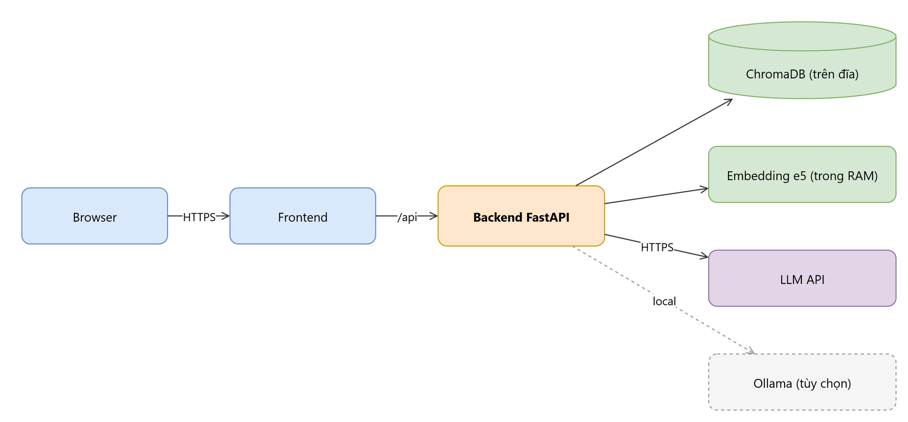

Bảng mô tả các nút triển khai:

| Nút | Vai trò |
|---|---|
| Browser | Chạy giao diện React |
| Frontend | Phục vụ tài nguyên tĩnh (Vite) |
| Backend FastAPI | Xử lý API, pipeline |
| ChromaDB (trên đĩa) | Lưu vector và đoạn |
| Embedding e5 (trong RAM) | Sinh vector cục bộ |
| LLM API | Tổng hợp câu trả lời (HTTPS) |
| Ollama (tùy chọn) | Mô hình cục bộ |

## 14.2 Môi trường triển khai

| Thành phần | Môi trường |
|---|---|
| Frontend | Node/Vite, cổng 5173 |
| Backend | Python/uvicorn, cổng 8000 |
| Cơ sở dữ liệu | ChromaDB lưu tại `./data/chroma` |

## 14.3 Quy trình triển khai

1. Cài phụ thuộc backend (tạo venv, `pip install -r requirements.txt`) và frontend (`npm install`).
2. Tạo `.env` từ `.env.example`, điền khóa mô hình ngôn ngữ và mật khẩu admin (băm).
3. Chạy backend (`uvicorn`) và frontend (`vite`); nạp dữ liệu luật qua khu quản trị.

---

# 15. MA TRẬN TRUY VẾT

## 15.1 Requirement → Use Case

| Requirement | Use Case |
|---|---|
| FR-01, FR-02, FR-03, FR-04, FR-11 | UC-01 |
| FR-07 | UC-02 |
| FR-10 | UC-03, UC-04, UC-05, UC-06 |
| FR-05, FR-06 | UC-04 |
| FR-08 | UC-05 |
| FR-09 | UC-06 |

## 15.2 Use Case → Phân tích

| Use Case | Lớp phân tích |
|---|---|
| UC-01 | Giao diện Chat, Bộ điều phối tra cứu, Kho điều luật, Embedding + LLM |
| UC-02 | Giao diện Chat/Quản lý, Kho điều luật |
| UC-03 | Giao diện Quản lý, Bộ xác thực admin |
| UC-04, UC-05, UC-06 | Giao diện Quản lý, Bộ điều phối nạp văn bản, Văn bản/Điều luật, Kho điều luật |

## 15.3 Phân tích → Thiết kế

| Lớp phân tích | Thành phần thiết kế |
|---|---|
| Bộ điều phối tra cứu | QueryPipeline |
| Bộ điều phối nạp văn bản | DocumentPipeline |
| Bộ xác thực admin | auth (hash/token/require_admin) |
| Kho điều luật (vector) | VectorStore, RetrievalStrategy |
| Embedding + LLM | HuggingFaceEmbedding, LLMProvider (Groq/Mistral/...) |
| Văn bản / Điều luật | Chunker, ChunkMetadata |

## 15.4 Thiết kế → Mã nguồn

| Thành phần thiết kế | Mã nguồn |
|---|---|
| QueryPipeline | pipelines/query_pipeline.py |
| DocumentPipeline | pipelines/document_pipeline.py |
| VectorStore | storage/vector_store.py |
| RetrievalStrategy / VectorStrategy | retrieval/base.py, retrieval/vector_strategy.py |
| Chunker | chunking/chunker.py |
| Auth | api/auth.py, api/routes/auth.py |
| Providers | providers/*.py |

## 15.5 Requirement → Test Case

| Requirement | Test Case | Tình trạng |
|---|---|---|
| FR-01, FR-02 | TC-001 | Có test pipeline; cần chạy lại |
| FR-03 | TC-002 | Có test pipeline; cần chạy lại |
| FR-04 | TC-003 | Có test pipeline; cần chạy lại |
| FR-05 | TC-004 | Cần bổ sung test API/pipeline đầy đủ |
| FR-06 | TC-005 | Cần bổ sung test trùng số hiệu/PDF ảnh quét |
| FR-07 | TC-006 | Cần bổ sung test phân trang |
| FR-08 | TC-007 | Cần bổ sung test cập nhật metadata |
| FR-09 | TC-008 | Có test tầng kho; cần test API |
| FR-10 | TC-009 | Cần bổ sung test xác thực API |
| FR-11 | TC-010 | Có test pipeline; cần chạy lại |

---

# 16. QUYẾT ĐỊNH VÀ ĐÁNH GIÁ THIẾT KẾ

## 16.1 Các phương án thiết kế

### Đơn vị cắt văn bản

**Vấn đề:** Chọn đơn vị chunk sao cho trích dẫn chính xác và giữ đủ ngữ cảnh.

**Phương án 1:** Cắt theo kích thước cố định (vd 500 từ). **Phương án 2:** Cắt theo đơn vị pháp lý (mỗi Điều một đoạn).

### Ngôn ngữ tra cứu và mô hình

**Vấn đề:** Chọn mô hình sinh vector và mô hình ngôn ngữ.

**Phương án 1:** Dùng dịch vụ embedding trả phí. **Phương án 2:** Dùng mô hình embedding đa ngữ chạy cục bộ (e5-large).

### Xác thực admin

**Vấn đề:** Bảo vệ thao tác ghi.

**Phương án 1:** Chỉ mật khẩu + token. **Phương án 2:** Cơ sở dữ liệu người dùng đầy đủ (nhiều tài khoản, vai trò).

## 16.2 Thiết kế được lựa chọn

- Cắt theo Điều (mỗi Điều một đoạn), Điều dài mới cắt nhỏ và gắn lại tiêu đề.
- Embedding e5-large cục bộ; mô hình ngôn ngữ chọn qua cấu hình.
- Xác thực chỉ mật khẩu + token HMAC (một vai trò admin).

## 16.3 Lý do lựa chọn

- Điều luật là đơn vị pháp lý hoàn chỉnh, giúp trích dẫn đúng và giữ ngữ cảnh (loại xe, mức phạt).
- Embedding cục bộ miễn phí, hỗ trợ tiếng Việt tốt, không phụ thuộc API.
- Xác thực mật khẩu đủ cho phạm vi đồ án, đơn giản, không thêm phụ thuộc.

## 16.4 Đánh đổi

### Ưu điểm

- Trích dẫn chính xác theo Điều; dễ mở rộng luật mới; đổi mô hình linh hoạt.
- Chạy cục bộ, chi phí thấp, dễ kiểm thử.

### Nhược điểm

- Một Điều rất dài phải cắt nhỏ, có thể phân mảnh ngữ cảnh (đã giảm thiểu bằng gắn lại tiêu đề Điều và gộp mảnh khi truy hồi).
- Chỉ một tài khoản admin, không phân quyền chi tiết.

## 16.5 Hạn chế

- Câu hỏi gõ không dấu vào embedding còn kém (dự kiến bổ sung bước chuẩn hóa).
- Chưa có kiểm chứng chéo câu trả lời bằng mô hình thứ hai.
- Mô hình nhỏ (gói miễn phí) đôi khi lẫn số Điều dù mức phạt đúng.

## 16.6 Hướng phát triển

- Chuẩn hóa câu không dấu trước khi tìm kiếm (thêm bước query `before_retrieval`).
- Kiểm chứng chéo câu trả lời bằng mô hình thứ hai (thêm bước query `after_answer`, dùng provider verify đã khai báo sẵn).
- Bổ sung xem toàn văn Điều, quản lý người dùng khi cần.

Làm giàu đoạn lúc lập chỉ mục (`EnrichStep`) và tìm kiếm lai vector + BM25 (`HybridStrategy`) đã được hiện thực và bật qua cấu hình, không còn là hướng phát triển.

---

# 17. KẾT LUẬN

## 17.1 Tổng kết đồ án

Đồ án đã phân tích, thiết kế và hiện thực một hệ thống RAG tra cứu luật giao thông: nạp văn bản → cắt theo Điều → sinh vector → truy hồi → tổng hợp câu trả lời có trích dẫn và nhãn độ tin cậy, kèm giao diện chat và khu quản trị có xác thực.

## 17.2 Mức độ hoàn thành mục tiêu

| Mục tiêu | Kết quả |
|---|---|
| Pipeline RAG hoàn chỉnh có trích dẫn | Đạt ở mức hiện thực; cần chạy lại bộ test trên môi trường mới |
| Chống bịa đặt bằng lọc ngưỡng và cơ chế dự phòng | Đạt ở mức thiết kế/hiện thực; cần đánh giá trên dữ liệu thật |
| Giao diện chat + khu quản trị có xác thực | Đạt; cần cấu hình bắt buộc mật khẩu khi triển khai |
| Kiến trúc module dễ mở rộng | Đạt |

## 17.3 Những kiến thức và kinh nghiệm đạt được

- Thiết kế pipeline RAG và cách kiểm soát chất lượng câu trả lời (gating, trích dẫn, fallback).
- Áp dụng mẫu Strategy/Pipeline/Factory/DI để hệ thống dễ mở rộng và kiểm thử.
- Làm việc với kho vector, mô hình embedding đa ngữ và nhiều nhà cung cấp mô hình ngôn ngữ.

---

# TÀI LIỆU THAM KHẢO

[1] IEEE, *IEEE 1016 – Systems and Software Engineering – Software Design Descriptions*.

[2] ISO/IEC/IEEE, *ISO/IEC/IEEE 42010 – Architecture Description*.

[3] Object Management Group, *Unified Modeling Language (UML) Specification*.

[4] Tài liệu ChromaDB, sentence-transformers (e5), FastAPI, React.

---

# PHỤ LỤC A – ĐẶC TẢ USE CASE ĐẦY ĐỦ

Sáu use case (UC-01 đến UC-06) đã được đặc tả đầy đủ tại mục 4.4 (tác nhân, mục tiêu, tiền/hậu điều kiện, luồng chính, luồng thay thế/ngoại lệ, quy tắc và yêu cầu liên quan).

# PHỤ LỤC B – CÁC SƠ ĐỒ UML

Toàn bộ sơ đồ (context, use case, domain model, analysis class, activity, architecture, component, design class, sequence, state, ERD, deployment) đặt tại `docs/design/diagrams/` (nguồn `.drawio`) và `docs/design/diagrams/png/` (ảnh).

# PHỤ LỤC C – TÀI LIỆU API

Đặc tả đầy đủ 6 endpoint tại chương 9.2 (request/response, mã trạng thái, yêu cầu xác thực).

# PHỤ LỤC D – CƠ SỞ DỮ LIỆU

Lược đồ bản ghi đoạn và từ điển dữ liệu tại chương 8.3–8.4.

# PHỤ LỤC E – TEST CASE ĐẦY ĐỦ

Mười test case (TC-001 đến TC-010) tại chương 13.5 phủ FR-01 đến FR-11. Bộ kiểm thử hiện có 44 hàm trên 7 tệp trong `backend/tests/`; các ca còn thiếu được ghi rõ trạng thái để bổ sung sau khi tạo lại môi trường ảo.

# PHỤ LỤC F – GIAO DIỆN HỆ THỐNG

Mô tả chi tiết các màn hình tại chương 9.1. Ảnh chụp màn hình các màn hình chính được đặt trong thư mục `docs/design/screenshots/` với tên tương ứng:

| Màn hình | Hình | Tệp ảnh |
|---|---|---|
| Trang Chat | Hình 9-1 | `screenshots/09-1-chat.png` |
| Trang Quản lý | Hình 9-2 | `screenshots/09-2-quanly.png` |
| Trang Đăng nhập | Hình 9-3 | `screenshots/09-3-dangnhap.png` |

# PHỤ LỤC G – CẤU TRÚC MÃ NGUỒN

Cấu trúc thư mục backend tại chương 12.2; frontend tại `frontend/src/` (pages, components, hooks, api, types).
